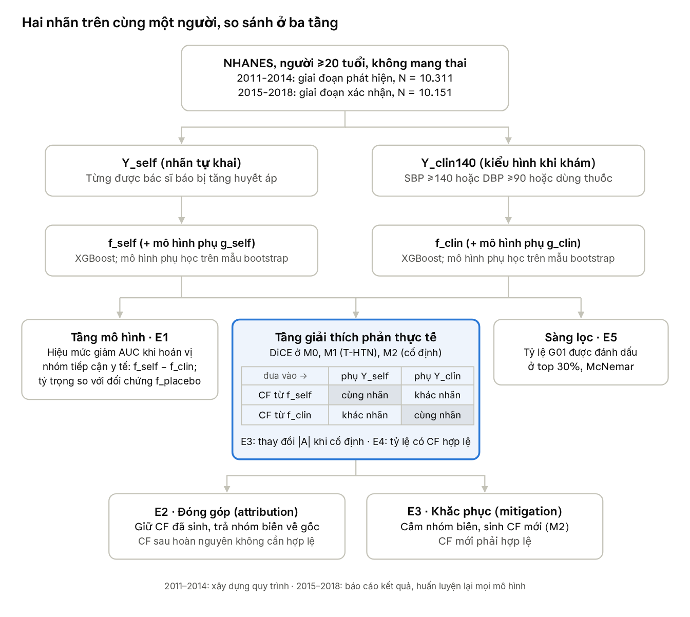
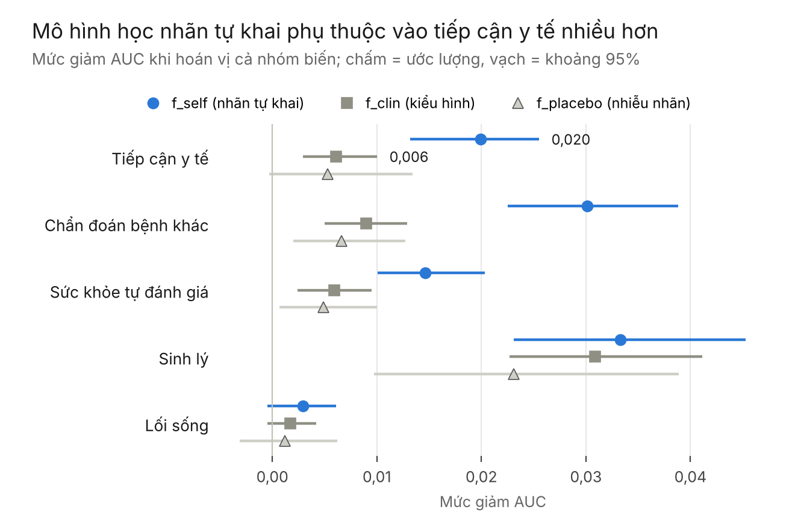
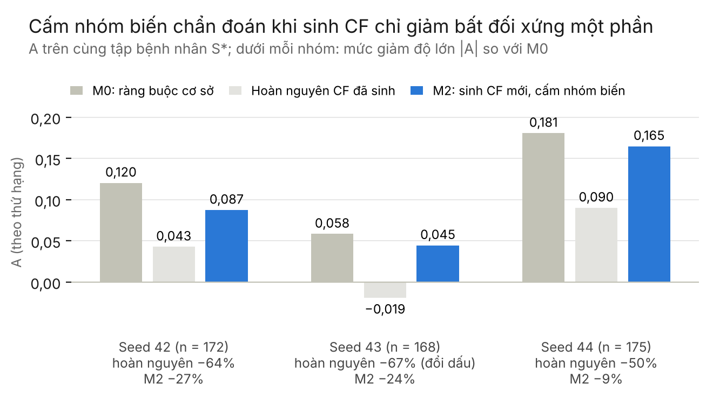
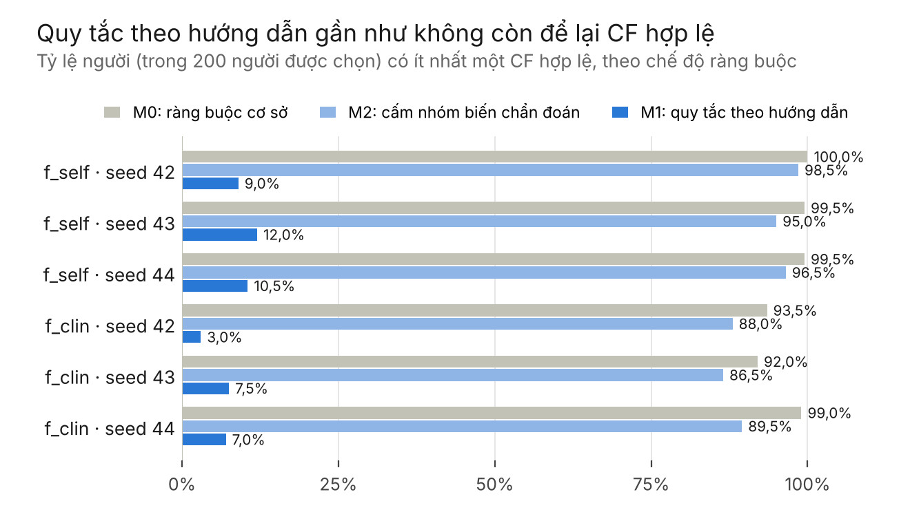

# Attribution is not mitigation: A paired-label counterfactual audit of hypertension classification models

**Xác định được đặc trưng đóng góp vào sự khác biệt không có nghĩa là hạn chế đặc trưng đó sẽ giảm được sự khác biệt: Kiểm định giải thích phản thực tế của mô hình phân loại tăng huyết áp bằng hai nhãn trên cùng một người**

Cong-Danh Tran — [Đơn vị, Thành phố, Việt Nam] · Email: [email] · ORCID: [ORCID]

*Bản tiếng Việt chốt, dùng làm nền để viết bản tiếng Anh. Mã thực nghiệm: commit 85a813b. Các ví dụ minh họa trong bài là giả định, không phải dữ liệu NHANES.*

## Điểm nổi bật (Highlights)

- Mô hình học từ nhãn tự khai dựa vào thông tin tiếp cận y tế nhiều hơn mô hình học từ nhãn kiểu hình tăng huyết áp ở cấu hình chính.
- Ở cả hai giai đoạn NHANES, những thay đổi thuộc nhóm biến liên quan đến chẩn đoán góp phần làm cho hai mô hình phụ có mức giảm điểm dự đoán khác nhau khi đánh giá cùng một CF.
- Trong giai đoạn 2015–2018, đưa nhóm biến đó trong CF đã sinh về giá trị ban đầu thu hẹp chênh lệch 50–67%; giữ nguyên nhóm biến khi sinh CF mới chỉ thu hẹp 9–27%.
- Với bộ quy tắc T-HTN, DiCE chỉ tìm được CF hợp lệ cho 3–12% số người được chọn ở giai đoạn 2015–2018.
- Khác biệt về mức độ dựa vào thông tin tiếp cận y tế không được xác nhận khi so sánh với nhãn chỉ dựa trên huyết áp đo ở người không dùng thuốc hạ áp.

**Từ khóa:** Counterfactual explanations; Explainable artificial intelligence; Clinical decision support; Label bias; Hypertension; Algorithmic recourse; NHANES; DiCE; XGBoost.

## Tóm tắt (Abstract)

**Bối cảnh.** Giải thích phản thực tế (counterfactual explanation, CF) cho biết cần thay đổi những giá trị đầu vào nào để một mô hình đổi kết quả phân loại. CF đang được nghiên cứu để sử dụng trong các hệ hỗ trợ quyết định lâm sàng. Tuy nhiên, nhãn tăng huyết áp dựa trên chẩn đoán tự khai có thể phản ánh cả tình trạng bệnh và việc một người có được phát hiện, chẩn đoán bệnh hay không. Các nghiên cứu trước đã chỉ ra giới hạn của phương pháp xác định đóng góp của đặc trưng và ảnh hưởng của cách định nghĩa nhãn lên CF. Vẫn cần làm rõ từng nhóm biến góp phần như thế nào vào sự khác biệt khi hai mô hình học từ hai định nghĩa nhãn lâm sàng.

**Mục tiêu.** Nghiên cứu trả lời ba câu hỏi: (1) Khi thay đổi định nghĩa nhãn tăng huyết áp, mức độ mô hình dựa vào từng nhóm biến để dự đoán thay đổi như thế nào? (2) Khi đưa cùng một CF vào hai mô hình phụ, nhóm biến liên quan đến chẩn đoán góp phần bao nhiêu vào chênh lệch giữa mức giảm điểm của hai mô hình? (3) Nếu giữ nguyên nhóm biến đó hoặc áp dụng thêm các quy tắc khi sinh CF mới, chênh lệch có giảm không?

**Phương pháp.** Mỗi người trong dữ liệu NHANES có hai nhãn: nhãn dựa trên việc từng được thông báo mắc tăng huyết áp và nhãn dựa trên huyết áp đo được hoặc việc đang dùng thuốc hạ áp (nhãn kiểu hình). Các mô hình XGBoost dùng cùng cấu hình, cùng đặc trưng và cùng dữ liệu, chỉ khác nhãn huấn luyện. Một mô hình đối chứng học từ nhãn kiểu hình sau khi một số nhãn được đảo ngẫu nhiên theo từng lớp. Quy trình gồm đo độ quan trọng của nhóm biến, sinh CF bằng DiCE, đưa mỗi CF vào cả hai mô hình phụ để tính mức giảm điểm, đưa nhóm biến trong CF về giá trị ban đầu (ablation), và sinh CF mới có ràng buộc. Quy trình được phát triển trên NHANES 2011–2014 (10.311 người) và được chạy với các mô hình huấn luyện lại từ đầu trên NHANES 2015–2018 (10.151 người).

**Kết quả.** Trong giai đoạn 2015–2018, hai nhãn khác nhau ở 12,9% người trưởng thành sau khi áp dụng trọng số khảo sát. Khi xáo trộn thông tin tiếp cận y tế, AUC của mô hình học nhãn tự khai giảm nhiều hơn mô hình học nhãn kiểu hình 0,014 [0,008; 0,019]. Tỷ trọng độ quan trọng của nhóm này cũng cao hơn mô hình đối chứng nhiễu nhãn. Tuy nhiên, khác biệt không được xác nhận khi dùng nhãn chỉ dựa trên huyết áp đo ở người không dùng thuốc. Khi đưa nhóm biến liên quan đến chẩn đoán trong CF về giá trị ban đầu, điểm của mô hình phụ học nhãn tự khai tăng trở lại nhiều hơn mô hình phụ học nhãn kiểu hình trung bình 4,3 điểm bách phân vị (E2 = 0,043; cận dưới 0,037; cùng dấu ở ba seed). Trên cùng tập người ở mỗi seed, thao tác này làm chênh lệch giữa mức giảm điểm của hai mô hình phụ thu hẹp 50–67%, trong khi giữ nguyên nhóm biến khi sinh CF mới chỉ thu hẹp 9–27%. Đây là so sánh mô tả; tác động của việc giữ nguyên nhóm biến không ổn định ở giai đoạn 2011–2014. Với bộ quy tắc T-HTN, chỉ 3–12% số người được chọn ở giai đoạn 2015–2018 có CF hợp lệ, nên chưa đủ dữ liệu để đánh giá mức giảm chênh lệch.

**Kết luận.** Biết nhóm biến nào góp phần làm cho hai mô hình có mức giảm điểm dự đoán khác nhau không có nghĩa là giữ nguyên nhóm biến ấy khi sinh CF mới sẽ làm giảm được chênh lệch một cách ổn định. PLCA cung cấp quy trình kiểm định bằng hai nhãn để đánh giá riêng những vấn đề này trước khi cân nhắc sử dụng CF trong hệ hỗ trợ quyết định lâm sàng. PLCA không phải công cụ chẩn đoán; CF không phải lời khuyên điều trị.

## Chú thích thuật ngữ để đọc bài

| Thuật ngữ | Nghĩa trong nghiên cứu |
|---|---|
| CF (counterfactual explanation) | Một bộ giá trị đầu vào giả định làm mô hình đổi kết quả phân loại. Không phải dự báo kết quả điều trị. |
| Nhãn (label) | Giá trị 0 hoặc 1 dùng làm kết quả cần dự đoán khi huấn luyện mô hình. |
| Nhãn tự khai, Y_self | Người tham gia cho biết đã từng được thông báo mắc tăng huyết áp hay chưa. |
| Nhãn kiểu hình, Y_clin | Nhãn xác định bằng huyết áp đo được hoặc việc đang dùng thuốc hạ áp, theo quy tắc của nghiên cứu. Không phải chuẩn vàng. |
| Mô hình sinh CF, f | Mô hình mà DiCE tìm cách làm đổi kết quả phân loại. |
| Mô hình phụ, g | Mô hình được huấn luyện thêm để đo mức giảm điểm khi nhận cùng một CF. |
| Điểm bách phân vị | Vị trí tương đối của điểm dự đoán so với phân bố điểm trên tập kiểm tra. Không phải xác suất mắc bệnh. |
| Reliance | Mức mô hình dựa vào một nhóm biến để dự đoán, đo bằng độ giảm AUC khi xáo trộn nhóm biến. |
| Attribution | Trong bài này, xác định mức đóng góp của nhóm biến trong các CF đã sinh bằng cách đưa nhóm biến về giá trị ban đầu. |
| Ablation | Thao tác đưa nhóm biến trong CF về giá trị trước khi thay đổi; không xóa cột dữ liệu, không huấn luyện lại mô hình. |
| Feature locking | Giữ nguyên giá trị nhóm biến của từng người trong suốt quá trình sinh CF mới. |
| Mitigation | Trong bài này, làm giảm chênh lệch về mức giảm điểm dự đoán giữa hai mô hình phụ. Không đồng nghĩa với giảm huyết áp hay loại bỏ mọi dạng thiên lệch. |
| Taxonomy T-HTN | Bộ quy tắc xác định biến nào được thay đổi, thay đổi theo chiều nào và trong khoảng nào. |
| Valid-CF coverage | Tỷ lệ người được thuật toán tìm thấy ít nhất một CF thỏa ràng buộc và làm mô hình sinh CF đổi kết quả. |
| Seed | Giá trị khởi tạo bộ sinh số ngẫu nhiên. Các seed không phải các mẫu nghiên cứu độc lập. |
| Bootstrap | Lấy mẫu lại có hoàn lại để đánh giá độ biến thiên của đại lượng ước lượng. |
| ECD, A, I, E2 | Các đại lượng đo mức giảm điểm trên thang bách phân vị; được định nghĩa cụ thể ở mục 3.5–3.6. |

## 1. Mở đầu

### 1.1. CF giải thích kết quả của mô hình, không trực tiếp giải thích tình trạng bệnh

Giải thích phản thực tế (CF) mô tả những thay đổi tương đối nhỏ trong đặc trưng của một người để làm mô hình đổi kết quả phân loại [1,2]. Trong hệ hỗ trợ quyết định lâm sàng [3], CF có thể được trình bày dưới dạng gợi ý như giảm vòng eo hoặc tăng vận động. Tuy nhiên, điều mà CF xác định được là những giá trị đầu vào nào khiến một mô hình cụ thể đổi kết quả. CF không tự chứng minh rằng nếu một người thực hiện những thay đổi đó ngoài đời thì tình trạng bệnh sẽ được cải thiện.

Mô hình được huấn luyện để dự đoán một nhãn nhất định. Nếu nhãn phản ánh cả tình trạng bệnh và quá trình phát hiện bệnh, mô hình có thể học cả hai loại thông tin. Do đó, CF không chỉ phụ thuộc vào dữ liệu và thuật toán huấn luyện mà còn phụ thuộc vào cách nhãn được định nghĩa.

### 1.2. Nhãn tăng huyết áp có thể phản ánh cả việc bệnh đã được phát hiện hay chưa

Nhiều người mắc tăng huyết áp nhưng chưa được chẩn đoán [4,5]. Vì vậy, trong khảo sát sức khỏe, câu trả lời về việc từng được thông báo mắc tăng huyết áp không nhất thiết giống với kết quả phân loại dựa trên huyết áp đo được. Một phân tích gộp (meta-analysis) cho thấy thông tin tự khai bỏ sót một phần người mắc tăng huyết áp [6]. Các nghiên cứu về nhãn thay thế và tình trạng ít được xét nghiệm cũng chỉ ra rằng quá trình ghi nhận bệnh có thể làm sai lệch kết quả dự đoán của mô hình [7,8].

Ví dụ, nếu hai người có huyết áp đo được tương tự nhau nhưng chỉ một người đã được thông báo mắc tăng huyết áp, nhãn tự khai của họ sẽ khác nhau. Đây chỉ là ví dụ minh họa, không phải trường hợp được trích từ NHANES. Nếu mô hình học nhãn tự khai, thông tin về bảo hiểm hoặc việc đi khám có thể hữu ích để dự đoán nhãn ấy, dù chúng không trực tiếp mô tả mức huyết áp.

Câu hỏi cần nghiên cứu tiếp là: sự khác biệt trong cách tạo nhãn có ảnh hưởng như thế nào đến CF mà mô hình đưa ra?

### 1.3. Khoảng trống nghiên cứu: biết nhóm biến đóng góp không đủ để biết cách giảm khác biệt

Ba hướng nghiên cứu có liên quan trực tiếp đến câu hỏi này là thiên lệch nhãn (label bias), độ ổn định của CF khi mô hình thay đổi và việc dùng tri thức chuyên môn để giới hạn những thay đổi được phép xuất hiện trong CF.

Thieu [9] đề xuất bộ quy tắc về chiều thay đổi của đặc trưng khi sinh CF cho bệnh tiểu đường trên dữ liệu BRFSS. Tác giả nêu khả năng một số thay đổi không phù hợp bắt nguồn từ việc mô hình học nhãn tự khai. Tuy nhiên, bộ dữ liệu được sử dụng không có nhãn dựa trên phép đo khách quan để đối chiếu. Cerrato và cộng sự [10] cho thấy khi thay đổi cách định nghĩa nhãn thu nhập, tập CF cũng thay đổi. PLCA bổ sung một cách đánh giá khác: đưa cùng một CF vào hai mô hình phụ học hai nhãn, đo mức giảm điểm của từng mô hình, rồi kiểm tra riêng tác động của việc giữ nguyên nhóm biến khi sinh CF mới.

Hai mô hình học từ hai nhãn khác nhau có thể đưa ra CF khác nhau. Việc quan sát thấy CF khác nhau chưa đủ để xác định những nhóm biến nào góp phần vào khác biệt và chưa cho biết nên hạn chế các biến đó như thế nào.

Khi một nhóm biến xuất hiện trong những CF không phù hợp, cách xử lý thường được cân nhắc là không cho phép thuật toán thay đổi nhóm biến ấy. Tuy nhiên, nếu bị hạn chế, thuật toán có thể tìm một tổ hợp thay đổi khác. Tổ hợp mới vẫn có thể làm điểm dự đoán của hai mô hình giảm khác nhau. Vì vậy, đo mức đóng góp của một nhóm biến trong CF đã có và đánh giá tác động của việc giữ nguyên nhóm biến khi sinh CF mới là hai công việc riêng biệt.

### 1.4. Nghiên cứu này

Chúng tôi đề xuất PLCA (Paired-Label Counterfactual Audit), một quy trình kiểm định CF bằng hai định nghĩa nhãn được ghi nhận trên cùng một người. PLCA không phải thuật toán sinh CF. NHANES phù hợp với thiết kế này vì người tham gia vừa cung cấp thông tin về việc từng được chẩn đoán tăng huyết áp, vừa được đo huyết áp trong cùng đợt khảo sát.

Các mô hình phân loại trong nghiên cứu được dùng để khảo sát sự khác biệt do cách định nghĩa nhãn, không nhằm thay thế phép đo huyết áp hoặc chẩn đoán của bác sĩ.

PLCA phân biệt ba câu hỏi:

1. **Reliance — Mức độ dựa vào đặc trưng:** Mô hình học nhãn tự khai có cần thông tin tiếp cận y tế để phân loại nhiều hơn mô hình học nhãn kiểu hình hay không?
2. **Attribution — Mức đóng góp của đặc trưng:** Khi cùng một CF được đưa vào hai mô hình phụ, những thay đổi thuộc nhóm biến liên quan đến chẩn đoán góp phần bao nhiêu vào chênh lệch giữa mức giảm điểm của hai mô hình?
3. **Mitigation — Tác động của việc hạn chế đặc trưng:** Nếu giữ nguyên nhóm biến đó khi sinh CF mới, chênh lệch có giảm không? Khi áp dụng bộ quy tắc T-HTN, còn đủ CF hợp lệ để đánh giá chênh lệch hay không?

**Đóng góp của nghiên cứu.** Thứ nhất, PLCA xây dựng cách kiểm định trong đó CF từ mỗi mô hình được đưa vào cả hai mô hình phụ, tạo thành bốn phép đánh giá cùng nhãn và khác nhãn. Một mô hình đối chứng nhiễu nhãn được dùng để bổ sung phép so sánh về độ quan trọng của nhóm biến. Thứ hai, PLCA phân biệt phép đo đóng góp của nhóm biến trong CF đã sinh (E2) với phép đánh giá việc sinh CF mới khi giữ nguyên nhóm biến (E3). Thứ ba, kết quả thực nghiệm cho thấy nhóm biến liên quan đến chẩn đoán có đóng góp vào chênh lệch mức giảm điểm ở cả hai giai đoạn NHANES, trong khi tác động của việc giữ nguyên nhóm biến không ổn định. Bộ quy tắc T-HTN còn làm giảm mạnh tỷ lệ người có CF hợp lệ, khiến chưa đủ dữ liệu để đánh giá mức giảm chênh lệch.

PLCA không đưa ra thuật toán sinh CF hay phép xáo trộn đặc trưng mới. Đóng góp nằm ở cách kết hợp các phép phân tích trên hai định nghĩa nhãn lâm sàng của cùng một người, nhằm phân biệt mức độ mô hình dựa vào đặc trưng, mức đóng góp của đặc trưng trong CF đã sinh, và kết quả của việc hạn chế đặc trưng khi sinh CF mới.

## 2. Nghiên cứu liên quan

### 2.1. Thiên lệch nhãn trong dữ liệu y tế

Khi không thể đo trực tiếp kết quả cần dự đoán, nghiên cứu có thể sử dụng một nhãn thay thế (proxy label). Mô hình học nhãn thay thế có thể học cả những yếu tố liên quan đến cách nhãn được ghi nhận. Obermeyer và cộng sự [7] cho thấy việc dùng chi phí y tế thay cho nhu cầu chăm sóc dẫn đến thiên lệch chủng tộc. Chang và cộng sự [8] nghiên cứu tình trạng các nhóm được xét nghiệm với tần suất khác nhau (disparate censorship): nhóm ít được xét nghiệm dễ bị ghi nhận là âm tính. Zanger-Tishler và cộng sự [11] chỉ ra rằng thêm đặc trưng vào mô hình học nhãn thay thế có thể gây bất lợi nếu đặc trưng liên quan đến nhãn và kết quả thật theo hai chiều trái ngược. Những công trình này tập trung vào dự đoán, trong khi PLCA còn xem xét lời giải thích của mô hình.

### 2.2. CF và khả năng thay đổi kết quả mô hình (algorithmic recourse)

CF là cách giải thích dự đoán mà không cần trực tiếp phân tích cấu trúc bên trong mô hình [1]. Nhiều nghiên cứu tổng quan đã trình bày các phương pháp này [12,13]. DiCE cho phép tìm nhiều CF khác nhau cho cùng một người [2]. Các nghiên cứu về recourse nhấn mạnh rằng thay đổi giá trị đầu vào làm mô hình đổi kết quả không đồng nghĩa với một can thiệp có thể thực hiện ngoài đời; các giả định khi diễn giải CF cần được nêu rõ [14,15].

CF có thể thay đổi khi dùng một mô hình khác, kể cả khi các mô hình có hiệu năng tương đương nhưng dự đoán khác nhau (predictive multiplicity) [16–18]. CARLA hỗ trợ so sánh các phương pháp CF bằng nhiều tiêu chí, chẳng hạn CF có làm mô hình đổi kết quả hay không (validity), giá trị mới cách giá trị ban đầu bao xa (proximity), và có bao nhiêu đặc trưng phải thay đổi (sparsity) [19]. Trong PLCA, mô hình phụ học cùng nhãn được dùng làm mốc so sánh với mô hình phụ học khác nhãn. Cách làm này chỉ giúp kiểm soát một phần sự khác nhau giữa các mô hình; nó không loại trừ hoàn toàn predictive multiplicity.

### 2.3. Sinh CF có ràng buộc theo kiến thức chuyên môn

Thieu [9] sử dụng bộ quy tắc về chiều thay đổi của đặc trưng cho bệnh tiểu đường. DANCE [20] đưa kiến thức chuyên môn vào quá trình sinh CF. FACE [21] hướng tới những CF có khả năng thực hiện tốt hơn trong thực tế. PLCA sử dụng bộ quy tắc T-HTN dựa trên hướng dẫn tăng huyết áp năm 2025 để kiểm tra kết quả của việc giới hạn các thay đổi. Nghiên cứu không giả định trước rằng áp dụng bộ quy tắc sẽ giảm chênh lệch giữa hai mô hình hoặc bảo đảm tính khả thi lâm sàng.

### 2.4. Cách định nghĩa nhãn và CF

Cerrato và cộng sự [10] thay đổi quy tắc gán nhãn thu nhập trên dữ liệu ACS và đo khoảng cách giữa các tập CF thu được. PLCA khác ở ba điểm. Hai nhãn trong PLCA là hai định nghĩa lâm sàng của cùng một người; mỗi CF được đánh giá trên cả mô hình phụ học cùng nhãn và khác nhãn; và nghiên cứu đo riêng mức đóng góp của nhóm biến trong CF đã sinh với tác động của việc giữ nguyên nhóm biến khi sinh CF mới. Hai nhãn khác nhau vốn có trong dữ liệu NHANES, thay vì được tạo ra hoàn toàn bằng cách thêm nhiễu nhân tạo. Nhãn nhiễu nhân tạo chỉ được dùng làm đối chứng.

Raikovskaia và cộng sự [22] cho thấy nhiễu nhãn có thể làm thay đổi lời giải thích của mô hình dựa trên luật dù hiệu năng dự đoán gần như không đổi. PLCA khảo sát hai định nghĩa nhãn có sẵn trên cùng một người và đo mức thay đổi điểm của hai mô hình khi đánh giá cùng một CF.

### 2.5. Xác định mức đóng góp của nhóm đặc trưng

Các phương pháp đo độ quan trọng của nhóm biến bằng hoán vị, huấn luyện lại hoặc giá trị Shapley đã được hệ thống hóa [23]. E2 không phải một phương pháp quy kết mới. Với mỗi CF đã sinh, E2 đưa một nhóm biến về giá trị ban đầu của người đó rồi đưa CF đã sửa vào hai mô hình phụ. Kết quả được lấy trung bình sao cho mỗi người và mỗi mô hình sinh CF có trọng số bằng nhau. Đại lượng cần ước lượng (estimand) là phần chênh lệch về mức giảm điểm theo thứ hạng giữa hai mô hình phụ gắn với những thay đổi của nhóm biến trong chính các CF đã sinh.

Mothilal và cộng sự [24] cho thấy các phương pháp quy kết đặc trưng và CF có thể xếp hạng đặc trưng khác nhau. Nếu giới hạn các biến được phép thay đổi khi sinh CF, những biến được xếp hạng cao không nhất thiết là điều kiện cần hoặc đủ để đổi kết quả. Các nghiên cứu khác chỉ ra những giới hạn về khả năng đồng thời bảo đảm độ nhạy và độ ổn định của các phương pháp quy kết [25], và nguy cơ suy luận sai hành vi mô hình từ một số phương pháp quy kết thỏa tính đầy đủ và tuyến tính [26]. Feature responsiveness là một hướng tiếp cận khác để đánh giá mức đáp ứng của đặc trưng trong bài toán recourse [27].

PLCA áp dụng sự phân biệt giữa quy kết và hạn chế đặc trưng vào bối cảnh hai định nghĩa nhãn lâm sàng của cùng một người. Nghiên cứu không tuyên bố là công trình đầu tiên chỉ ra rằng xác định mức đóng góp của đặc trưng khác với việc giảm vấn đề bằng cách hạn chế đặc trưng đó.

## 3. Phương pháp

### 3.1. Thiết kế nghiên cứu và dữ liệu

Nghiên cứu sử dụng dữ liệu công khai đã được thu thập trong Khảo sát Dinh dưỡng và Sức khỏe Quốc gia Hoa Kỳ (National Health and Nutrition Examination Survey, NHANES) [28,29]. Đây là phân tích thứ cấp, nghĩa là nghiên cứu không tuyển người tham gia hoặc thu thập dữ liệu mới.

Dữ liệu được chia thành hai giai đoạn. Giai đoạn phát hiện (discovery, 2011–2014) gồm 10.311 người, được dùng để xây dựng quy trình phân tích. Giai đoạn 2015–2018 gồm 10.151 người, được dùng để đánh giá kết quả trên dữ liệu ở thời điểm khác. Tất cả mô hình được huấn luyện lại từ đầu trong từng giai đoạn. Đây là việc áp dụng lại quy trình kiểm định trên dữ liệu thuộc giai đoạn khác của cùng một khảo sát, không phải thẩm định ngoài (external validation) một mô hình đã huấn luyện.

Mẫu phân tích gồm những người từ 20 tuổi trở lên, không mang thai, có số đo huyết áp hợp lệ, có câu trả lời cho câu hỏi về chẩn đoán tăng huyết áp (BPQ020) và xác định được tình trạng dùng thuốc hạ áp. NHANES đo huyết áp bằng phương pháp nghe. Nếu một người có từ hai lần đo hợp lệ trở lên, nghiên cứu lấy trung bình các lần đo hợp lệ trong lần đo thứ hai đến thứ tư. Nếu chỉ có một lần đo hợp lệ, nghiên cứu sử dụng lần đo đó.

**Hình 1.** Quy trình PLCA. Hai mô hình chính dùng cùng đặc trưng, cùng dữ liệu và cùng cấu hình, nhưng học hai nhãn khác nhau. Mỗi CF được đưa vào cả hai mô hình phụ để tính mức giảm điểm. E2 sử dụng các CF đã sinh; E3 sinh CF mới khi không cho phép thay đổi nhóm biến. Các kết quả được so sánh trong phạm vi mô hình và dữ liệu nghiên cứu, không được dùng để kết luận quan hệ nhân quả lâm sàng.

**Bảng 1. Đặc điểm của mẫu nghiên cứu NHANES 2015–2018 theo cặp nhãn, với ngưỡng huyết áp 140/90 mmHg.**

| Đặc điểm | Toàn mẫu | G00 (cả hai −) | G01 (chỉ Y_clin +) | G10 (chỉ Y_self +) | G11 (cả hai +) |
|---|---|---|---|---|---|
| Số người (không trọng số) | 10.151 | 5.533 | 785 | 562 | 3.271 |
| **Nhân khẩu học** | | | | | |
| Tuổi, năm, TB (SD) | 48,4 (17,2) | 42,1 (15,6) | 56,4 (15,3) | 44,5 (15,5) | 61,2 (13,0) |
| Tuổi 20–39, % | 35,2 | 49,0 | 16,6 | 46,0 | 6,9 |
| Tuổi 40–59, % | 35,8 | 35,4 | 40,5 | 34,3 | 35,8 |
| Tuổi ≥60, % | 29,0 | 15,6 | 42,9 | 19,7 | 57,3 |
| Nữ, % | 51,1 | 52,3 | 45,3 | 41,7 | 51,9 |
| Người Mỹ gốc Mexico, % | 8,7 | 10,2 | 9,1 | 8,8 | 5,3 |
| Hispanic khác, % | 6,5 | 7,2 | 6,0 | 6,8 | 5,1 |
| Da trắng không Hispanic, % | 63,7 | 62,7 | 63,7 | 63,8 | 65,8 |
| Da đen không Hispanic, % | 11,3 | 9,7 | 12,1 | 10,9 | 14,7 |
| Châu Á không Hispanic, % | 5,7 | 6,3 | 5,7 | 3,8 | 4,7 |
| Khác / đa chủng tộc, % | 4,2 | 4,0 | 3,4 | 6,0 | 4,5 |
| **Kinh tế – xã hội** | | | | | |
| Dưới THPT, % | 12,5 | 11,5 | 13,6 | 12,2 | 14,6 |
| THPT / GED, % | 24,2 | 22,6 | 28,0 | 24,3 | 26,8 |
| Cao đẳng / đại học chưa xong, % | 31,7 | 30,6 | 28,1 | 35,1 | 34,3 |
| Tốt nghiệp đại học trở lên, % | 31,6 | 35,4 | 30,3 | 28,4 | 24,3 |
| Tỷ số thu nhập/ngưỡng nghèo < 1,3, % | 20,3 | 19,8 | 20,5 | 25,5 | 20,1 |
| **Tiếp cận y tế** | | | | | |
| Có bảo hiểm, % | 86,5 | 84,0 [81,2; 86,8] | 88,8 [85,2; 92,5] | 82,4 [77,2; 87,6] | 92,5 [90,4; 94,5] |
| Có nơi khám thường xuyên, % | 82,6 | 78,0 [75,8; 80,1] | 81,8 [77,9; 85,7] | 78,7 [72,5; 84,8] | 93,9 [92,6; 95,2] |
| Có đi khám trong năm, % | 83,9 | 79,1 [77,5; 80,7] | 78,8 [74,5; 83,0] | 82,2 [78,4; 86,0] | 96,2 [95,3; 97,0] |
| **Chỉ số sinh lý và điều trị** | | | | | |
| BMI, kg/m², TB (SD) | 29,6 (7,1) | 28,3 (6,7) | 30,3 (7,3) | 30,9 (7,4) | 32,0 (7,2) |
| SBP, mmHg, TB (SD) | 123,7 (17,7) | 115,8 (10,8) | 148,2 (13,1) | 122,0 (9,7) | 135,3 (20,0) |
| DBP, mmHg, TB (SD) | 71,7 (11,4) | 69,7 (9,1) | 82,3 (13,1) | 72,5 (10,0) | 73,2 (13,7) |
| Đang dùng thuốc hạ áp, % | 24,1 | 0 | 0 | 0 | 89,2 |

*Chú thích:* G00: cả hai nhãn bằng 0; G01: nhãn kiểu hình bằng 1, nhãn tự khai bằng 0; G10: nhãn tự khai bằng 1, nhãn kiểu hình bằng 0; G11: cả hai nhãn bằng 1. TB là trung bình; SD là độ lệch chuẩn. SBP và DBP lần lượt là huyết áp tâm thu và tâm trương. Các tỷ lệ và giá trị trung bình được tính với trọng số khảo sát WTMEC2YR chia cho số chu kỳ. Số người trong mẫu không dùng trọng số. Khoảng tin cậy 95% của ba chỉ số tiếp cận y tế được tính bằng tuyến tính hóa Taylor, có xét thiết kế khảo sát (30 tầng, 60 đơn vị mẫu bậc một; ước lượng cho nhóm con trên toàn bộ mẫu khám MEC). Các dòng khác báo cáo ước lượng điểm. Một người thuộc G00 thiếu thông tin nơi khám thường xuyên và đi khám. Tỷ lệ dùng thuốc bằng 0 ở G00, G01 và G10 xuất phát từ cách định nghĩa nhãn và cấu trúc bảng hỏi. Nguồn: `results/confirmation/T1c_demographics_confirmation.csv` và `results/confirmation/design_se`.

### 3.2. Hai định nghĩa nhãn tăng huyết áp

Nghiên cứu tạo hai nhãn nhị phân (0 hoặc 1) từ dữ liệu của mỗi người:

- **Y_self (nhãn tự khai):** bằng 1 nếu người tham gia cho biết đã từng được thông báo mắc tăng huyết áp; bằng 0 nếu trả lời chưa từng được thông báo.
- **Y_clin (nhãn kiểu hình):** bằng 1 nếu huyết áp tâm thu từ 140 mmHg trở lên, huyết áp tâm trương từ 90 mmHg trở lên, hoặc người đó đang dùng thuốc hạ áp; bằng 0 nếu không có điều kiện nào trong ba điều kiện trên.

Ngưỡng 140/90 mmHg là ngưỡng được chọn để xây dựng nhãn chính trong nghiên cứu. Ngưỡng 130/80 mmHg theo hướng dẫn năm 2017 [4] được dùng trong phân tích độ nhạy (sensitivity analysis, tức kiểm tra xem kết quả có thay đổi khi thay một giả định hoặc cấu hình hay không).

Thông tin dùng thuốc được xác định từ hai câu hỏi BPQ040A và BPQ050A. Hai câu này chỉ được hỏi đối với người đã từng được thông báo mắc tăng huyết áp. Vì vậy, người trả lời chưa từng được chẩn đoán được tính là không dùng thuốc theo cấu trúc bỏ qua câu hỏi của NHANES. Người không xác định được tình trạng dùng thuốc bị loại khỏi mẫu.

Y_clin là nhãn kiểu hình được xây dựng từ thông tin thu thập khi khảo sát, không phải nhãn chuẩn tuyệt đối (ground truth). Đặc biệt, thành phần đang dùng thuốc trong định nghĩa này vẫn có liên quan đến quá trình chẩn đoán trước đó. Hai nhãn còn khác nhau về thời gian: Y_self nói đến việc đã từng được chẩn đoán, còn Y_clin sử dụng huyết áp tại thời điểm khảo sát và việc đang dùng thuốc.

Theo cặp (Y_self, Y_clin), mỗi người thuộc một trong bốn nhóm:

| Nhóm | Y_self | Y_clin | Cách đọc |
|---|---:|---:|---|
| G00 | 0 | 0 | Không cho biết từng được chẩn đoán; không thỏa định nghĩa kiểu hình. |
| G01 | 0 | 1 | Không cho biết từng được chẩn đoán; thỏa định nghĩa kiểu hình. |
| G10 | 1 | 0 | Cho biết từng được chẩn đoán; không thỏa định nghĩa kiểu hình. |
| G11 | 1 | 1 | Cho biết từng được chẩn đoán; đồng thời thỏa định nghĩa kiểu hình. |

Không mặc định mọi người trong G01 đều mắc bệnh chưa được chẩn đoán, hoặc mọi người trong G10 đều khai sai. Những trường hợp không thống nhất nhãn có thể xuất hiện vì nhiều lý do.

### 3.3. Các đặc trưng đầu vào

Mô hình sử dụng sáu nhóm đặc trưng:

| Nhóm | Đặc trưng |
|---|---|
| Nhân khẩu học và kinh tế – xã hội | Tuổi, giới, chủng tộc/dân tộc, học vấn, thu nhập so với ngưỡng nghèo. |
| Tiếp cận y tế | Bảo hiểm, nơi khám thường xuyên, thông tin về số lần đi khám. |
| Chẩn đoán bệnh khác | Tiền sử được chẩn đoán tiểu đường, rối loạn mỡ máu. |
| Lối sống | Hút thuốc, lượng rượu trong ngày có uống, vận động giải trí vừa và mạnh. |
| Chỉ số sinh lý | BMI, vòng eo, cholesterol toàn phần, HbA1c. |
| Sức khỏe tự đánh giá | Câu trả lời của người tham gia về tình trạng sức khỏe của mình (self-rated health, SRH). |

Không dùng số đo huyết áp hoặc các câu hỏi về huyết áp làm đầu vào. Như vậy, mô hình không được cung cấp trực tiếp thông tin đã dùng để xác định hai nhãn.

Biến cho biết đã từng kiểm tra cholesterol (chol_checked, BPQ060) bị loại khỏi cấu hình chính, phù hợp với lựa chọn ở giai đoạn phát hiện. Do cấu trúc bỏ qua câu hỏi, tỷ lệ thiếu của biến này khác nhau rõ rệt theo nhãn tự khai: trong giai đoạn 2015–2018, tỷ lệ thiếu là 57,8% ở nhóm Y_self = 1 và 26,0% ở nhóm Y_self = 0. Một phiên bản được dựng lại theo cấu trúc bảng hỏi được dùng trong phân tích độ nhạy. Việc loại biến này không đồng nghĩa với kết luận rằng bản thân biến đó đã được chứng minh là gây rò rỉ nhãn.

Trong phân tích E1, XGBoost xử lý trực tiếp giá trị thiếu. Trong phân tích CF, nghiên cứu thay giá trị thiếu bằng trung vị tính trên tập huấn luyện vì DiCE cần dữ liệu đầu vào đầy đủ. Các mô hình dùng trong phân tích CF được huấn luyện với cách xử lý thiếu tương ứng.

Trong phần còn lại của bài, ba nhóm **tiếp cận y tế, chẩn đoán bệnh khác và sức khỏe tự đánh giá** được gọi chung là nhóm biến liên quan đến chẩn đoán. Tên gọi này dùng để xác định nhóm biến cần kiểm định, không có nghĩa rằng mọi biến trong nhóm đều chỉ phản ánh quá trình chẩn đoán hoặc đều là nguyên nhân gây thiên lệch nhãn.

### 3.4. Đo mức độ mô hình dựa vào từng nhóm biến (E1)

Ba mô hình XGBoost [30] được huấn luyện với cùng tập đặc trưng, cùng dữ liệu và cùng cấu hình: 300 cây, độ sâu tối đa 4, tốc độ học 0,05, tỷ lệ lấy mẫu hàng và cột đều bằng 0,8. Dữ liệu được chia thành 70% để huấn luyện và 30% để kiểm tra, phân tầng theo Y_clin. Phân tầng giúp duy trì tỷ lệ lớp của nhãn kiểu hình khi chia dữ liệu.

Hai mô hình chính là f_self, học Y_self, và f_clin, học Y_clin. Mô hình đối chứng f_placebo học từ một nhãn tạo bằng cách đảo ngẫu nhiên một phần giá trị Y_clin. Tỷ lệ đảo được ước lượng riêng cho lớp 0 và lớp 1 từ tập huấn luyện. Xác suất đảo nhãn chỉ phụ thuộc vào lớp Y_clin, không phụ thuộc vào đặc trưng đầu vào. Nhãn nhiễu được tạo lại trong mỗi lần bootstrap.

Mục đích của mô hình đối chứng là kiểm tra xem một cơ chế nhiễu nhãn ngẫu nhiên theo lớp có tạo ra mức độ dựa vào nhóm tiếp cận y tế tương tự mô hình học nhãn tự khai hay không. Mô hình đối chứng này không đại diện cho mọi cơ chế có thể làm hai nhãn khác nhau.

Nghiên cứu dùng độ quan trọng theo phép hoán vị nhóm biến (grouped permutation importance) [31,32]. Đối với mỗi nhóm, xáo trộn đồng thời các giá trị trong nhóm giữa các người thuộc tập kiểm tra, rồi tính lại AUC. Nếu AUC giảm nhiều, mô hình cần thông tin của nhóm biến đó nhiều hơn để phân biệt hai lớp trên tập kiểm tra. Nghiên cứu lấy trung bình của ba lần hoán vị. AUC là diện tích dưới đường cong ROC, dùng để đo khả năng phân biệt lớp dương tính và âm tính.

Cách tính tỷ trọng độ quan trọng: đặt các giá trị độ quan trọng âm về 0, sau đó chia độ quan trọng của từng nhóm cho tổng độ quan trọng dương của tất cả nhóm. Tỷ trọng này bổ sung cho mức giảm AUC tuyệt đối, chứ không thay thế nó.

Bootstrap hai tầng [33] được thực hiện 100 lần (B = 100). Mỗi lần lấy mẫu lại tập huấn luyện để huấn luyện lại mô hình và lấy mẫu lại tập kiểm tra để đánh giá. Các mô hình dùng cùng mẫu kiểm tra và cùng thứ tự hoán vị trong một lần bootstrap. Vì vậy, khoảng ước lượng phản ánh cả biến thiên do huấn luyện lại và do thay đổi mẫu kiểm tra.

### 3.5. Sinh CF và so sánh mức giảm điểm của hai mô hình phụ

#### 3.5.1. Chọn người để sinh CF

Nghiên cứu chọn tối đa 200 người từ tập kiểm tra, thỏa hai điều kiện: không dùng thuốc hạ áp và được cả f_self lẫn f_clin dự đoán dương tính (điểm xác suất từ 0,5 trở lên). Nếu có ít hơn 200 người đủ điều kiện, chọn tất cả. Khi có nhiều hơn 200 người, ưu tiên người có trung bình bách phân vị điểm của hai mô hình cao nhất. Hai mô hình sinh CF dùng cùng danh sách người được chọn.

DiCE [2] phiên bản 0.12, với phương pháp tìm kiếm random, được yêu cầu tìm tối đa năm CF cho mỗi người ở từng chế độ. Không phải lúc nào thuật toán cũng tìm được đủ năm CF hợp lệ.

#### 3.5.2. Ba chế độ sinh CF chính

| Chế độ | Thuật toán được phép làm gì? | Mục đích so sánh |
|---|---|---|
| M0 — Ràng buộc cơ sở | Giữ nguyên tuổi, giới và chủng tộc/dân tộc; cho phép thay đổi những biến còn lại trong phạm vi tìm kiếm. | Mốc so sánh. |
| M1 — T-HTN | Chỉ cho phép thay đổi tám đặc trưng theo các quy tắc cụ thể; giữ nguyên mọi biến còn lại và những giá trị được điền thay ở từng người. | Kiểm tra khả năng tìm CF khi áp dụng bộ quy tắc có căn cứ từ hướng dẫn y khoa. |
| M2 — Giữ nguyên nhóm biến liên quan đến chẩn đoán | Như M0, đồng thời giữ nguyên cả ba nhóm: tiếp cận y tế, chẩn đoán bệnh khác và SRH. Không áp dụng các quy tắc T-HTN. | Kiểm tra tác động của việc không cho phép thay đổi nhóm biến liên quan đến chẩn đoán. |

Trong M1, bộ quy tắc T-HTN được xây dựng từ khuyến nghị y khoa, cách chuyển khuyến nghị thành quy tắc trên biến NHANES, ý nghĩa của dữ liệu và các quyết định thiết kế nghiên cứu. Bảo hiểm và nơi khám thường xuyên chỉ được chuyển từ không có sang có; tình trạng đang hút thuốc chỉ được chuyển sang không hút thuốc hiện tại; lượng rượu mỗi ngày có uống chỉ được giảm xuống mức thấp nhất là một ly nếu ban đầu lớn hơn một; vận động vừa và mạnh chỉ được chuyển từ không sang có. BMI chỉ được giảm khi vượt ngưỡng 25 kg/m² (23 đối với nhóm châu Á không Hispanic), và không giảm dưới ngưỡng [34]. Vòng eo chỉ được giảm khi vượt ngưỡng 102 cm ở nam hoặc 88 cm ở nữ, và không giảm dưới ngưỡng tương ứng [35,36]. Các biến khác, gồm SRH, cholesterol toàn phần và HbA1c, được giữ nguyên. Nếu giá trị của một biến được điền thay do thiếu dữ liệu, biến đó được giữ nguyên cho người tương ứng ở M1 và M3. Bảng A4 trình bày căn cứ và giới hạn của từng quy tắc.

M1 và M2 là hai cách giới hạn khác nhau, không phải hai mức liên tiếp của cùng một bộ quy tắc. Chẳng hạn, M1 cho phép tăng khả năng tiếp cận y tế, còn M2 không cho phép thay đổi nhóm này.

Một CF hợp lệ phải thỏa cả hai điều kiện: tuân thủ các quy tắc của chế độ đang xét và làm mô hình đã sinh CF chuyển dự đoán từ dương tính sang âm tính. Tính hợp lệ này được xác định đối với mô hình, không phải đối với sức khỏe hoặc khả năng thực hiện ngoài đời của người tham gia.

#### 3.5.3. Vì sao cần hai mô hình phụ?

Nếu chỉ đánh giá CF bằng chính mô hình đã sinh ra nó, ta chủ yếu biết CF có làm mô hình đó đổi kết luận hay không. Để kiểm tra cùng một CF có làm thay đổi điểm trên mô hình học nhãn khác hay không, nghiên cứu huấn luyện thêm một mô hình phụ cho mỗi nhãn, g_self và g_clin. Hai mô hình phụ được huấn luyện trên cùng một mẫu bootstrap lấy từ tập huấn luyện. Các mô hình sinh CF vẫn được ký hiệu là f_self và f_clin.

Mỗi CF, bất kể được sinh từ f_self hay f_clin, đều được đưa vào cả g_self và g_clin. Ta tính mức giảm điểm khi đưa bộ đặc trưng ban đầu và bộ đặc trưng trong CF vào từng mô hình phụ. Việc có một mô hình phụ cùng nhãn giúp cung cấp mốc so sánh khi đánh giá trên mô hình học khác nhãn. Thiết kế này chưa kiểm soát được tất cả sự khác nhau giữa các mô hình có hiệu năng tương đương.

#### 3.5.4. Quy đổi điểm dự đoán sang thang bách phân vị

Hai mô hình có thể cho ra phân bố điểm khác nhau, nên không thể mặc định mức giảm của xác suất dự đoán ở hai mô hình có cùng ý nghĩa. Nghiên cứu quy đổi điểm của mỗi mô hình phụ sang vị trí của điểm đó trong phân bố điểm dự đoán của chính mô hình trên tập kiểm tra.

Với mỗi mô hình phụ g_m, ký hiệu p_m(x) là điểm bách phân vị của x: tỷ lệ người trong tập kiểm tra có điểm g_m không cao hơn điểm của x (hàm phân phối thực nghiệm, ECDF). p_m(x) nằm trong khoảng 0–1. Chẳng hạn, giá trị 0,90 nghĩa là điểm nằm ở khoảng bách phân vị thứ 90 của phân bố tham chiếu. Đây không phải xác suất mắc tăng huyết áp 90%.

Với người i, gọi x_i là bộ đặc trưng ban đầu và x′ là bộ đặc trưng trong CF. Mức giảm điểm trên mô hình phụ g_m là:

$$\Delta_m(x')=p_m(x_i)-p_m(x').$$

Nếu điểm theo thứ hạng giảm từ 0,90 xuống 0,50 thì mức giảm là 0,40, tức 40 điểm bách phân vị. Nếu đại lượng này âm, điểm của mô hình thực tế tăng sau khi đưa CF vào. Tất cả các đại lượng R, ECD, A và E2 ở phần CF được tính trên thang này; 0,01 tương đương một điểm bách phân vị. Việc quy đổi không bảo đảm hai mô hình có độ nhạy như nhau.

**Ví dụ minh họa, không phải kết quả NHANES.** Giả sử cả hai mô hình phụ có điểm ban đầu ở bách phân vị 90. Sau khi đưa cùng một CF vào hai mô hình, điểm của g_self xuống bách phân vị 50, còn điểm của g_clin xuống bách phân vị 70. Mức giảm tương ứng là 40 và 20 điểm bách phân vị. Trong ví dụ này, cùng một CF làm điểm của g_self giảm nhiều hơn g_clin 20 điểm bách phân vị. Đây là ý nghĩa cụ thể của việc hai mô hình có mức thay đổi điểm khác nhau trước cùng một CF.

#### 3.5.5. Ma trận đánh giá CF trên hai mô hình phụ (ma trận chuyển giao)

Gọi R_sm là mức giảm điểm trung bình trên mô hình phụ m khi CF được sinh bởi mô hình s. Trước hết, tính trung bình các CF hợp lệ của từng người; sau đó lấy trung bình giữa các người trong tập phân tích. Vì vậy, người có nhiều CF không được tự động tính với trọng số lớn hơn người có ít CF.

Hai chỉ số s và c lần lượt đại diện cho nhãn tự khai và nhãn kiểu hình. Bốn phép đánh giá tạo thành ma trận sau:

| Nguồn CF | Đưa vào g_self | Đưa vào g_clin |
|---|---|---|
| CF do f_self sinh | R_ss | R_sc |
| CF do f_clin sinh | R_cs | R_cc |

Từ ma trận này, nghiên cứu tính hai đại lượng: ECD và A.

**ECD — Chênh lệch giữa mức giảm điểm trên mô hình phụ cùng nhãn và khác nhãn.** Đối với CF do f_self sinh, so sánh mức giảm trên g_self với mức giảm trên g_clin. Đối với CF do f_clin sinh, làm ngược lại để vẫn giữ ý nghĩa cùng nhãn trừ khác nhãn:

$$\mathrm{ECD}_{self}=R_{ss}-R_{sc},\qquad \mathrm{ECD}_{clin}=R_{cc}-R_{cs}.$$

ECD dương nghĩa là CF làm điểm của mô hình phụ học cùng nhãn giảm nhiều hơn điểm của mô hình phụ học khác nhãn. ECD âm nghĩa là mức giảm lớn hơn ở mô hình phụ học khác nhãn. Hai ECD cần được đọc theo nguồn CF tương ứng.

**A — Đại lượng so sánh mức giảm điểm giữa hai mô hình phụ.** Ta cần một đại lượng tổng hợp để trả lời: nếu tính CF từ hai mô hình sinh với trọng số bằng nhau, điểm của mô hình phụ nào giảm nhiều hơn và chênh nhau bao nhiêu?

$$A=\mathrm{ECD}_{self}-\mathrm{ECD}_{clin}=(R_{ss}+R_{cs})-(R_{sc}+R_{cc}).$$

Cách đọc chính xác là **A/2 bằng chênh lệch giữa mức giảm điểm trung bình của g_self và g_clin**, khi CF từ hai nguồn được tính với trọng số bằng nhau. Nếu A dương, điểm của g_self giảm nhiều hơn; nếu A âm, điểm của g_clin giảm nhiều hơn. A được gọi là độ bất đối xứng chuyển giao (transfer asymmetry) trong thuật ngữ của PLCA. Khi nói một cách dễ hiểu, bài dùng cụm “chênh lệch về mức giảm điểm giữa hai mô hình phụ”; khi nói về tỷ lệ thu hẹp chênh lệch, bài tính theo |A|. Tỷ lệ giảm của |A| và |A/2| giống nhau.

Dấu của A và độ lớn |A| mang ý nghĩa khác nhau. Dấu cho biết mô hình nào có mức giảm điểm lớn hơn. Độ lớn cho biết hai mức giảm cách nhau bao xa. A đổi dấu chưa chắc đồng nghĩa với chênh lệch tăng. Ví dụ A giảm từ 0,040 xuống −0,032 thì mô hình có mức giảm điểm lớn hơn đã thay đổi, nhưng |A| vẫn giảm khoảng 20%.

Phụ lục A2 báo cáo thêm một đại lượng mô tả, I = ECD_self + ECD_clin, cho biết xét chung hai nguồn CF thì mức giảm điểm trên mô hình phụ cùng nhãn lớn hơn trên mô hình phụ khác nhãn bao nhiêu. I không phải tiêu chí đánh giá. A bằng 0 không có nghĩa là CF giống nhau, CF tốt, hay hai nhãn không còn khác biệt.

Các đại lượng trên chỉ đo thay đổi điểm của mô hình trên thang thứ hạng. Chúng không đo mức thay đổi nguy cơ tăng huyết áp thật. Do nghiên cứu chỉ dùng một mô hình phụ cho mỗi nhãn, vẫn có thể có kết quả khác nếu huấn luyện những mô hình tương đương khác. Phụ lục A trình bày công thức chi tiết cho từng CF.

#### 3.5.6. Tập người dùng trong từng phép so sánh

Không phải người được chọn nào cũng có CF hợp lệ từ cả hai mô hình ở mọi chế độ. Vì vậy, nghiên cứu xác định riêng tập người cho từng phép phân tích:

- S0: những người có ít nhất một CF hợp lệ từ cả f_self và f_clin ở M0. Đây là tập chính để tính E2.
- S02: những người có CF hợp lệ từ cả hai mô hình ở cả M0 và M2 (giao của S0 và S_M2). Đây là tập để tính E3. Khi đối chiếu mức giảm |A| do ablation với mức giảm |A| do giữ nguyên nhóm biến, E2 cũng được tính lại trên chính S02.
- Đối với phần ECD của E4: những người có CF hợp lệ từ f_self ở cả M0 và M1. Tỷ lệ tìm được CF được báo cáo riêng theo từng mô hình sinh và chế độ.

Dùng tập chung trong một phép so sánh giúp tránh thay đổi danh sách người giữa hai chế độ. Tuy nhiên, kết quả vẫn chỉ áp dụng cho nhóm người có CF hợp lệ cần thiết, không đại diện tự động cho toàn bộ 200 người được chọn hoặc dân số NHANES.

### 3.6. Các tiêu chí đánh giá

**Bảng 2. Câu hỏi mà từng tiêu chí trả lời và cách đo.**

| Tiêu chí | Câu hỏi nghiên cứu | Đại lượng được tính | Vai trò |
|---|---|---|---|
| E1 — Reliance | Mô hình học nhãn tự khai dựa vào thông tin tiếp cận y tế nhiều hơn không? | Chênh lệch mức giảm AUC của nhóm tiếp cận y tế giữa f_self và f_clin; chênh lệch tỷ trọng độ quan trọng giữa f_self và f_placebo. | Chính |
| E2 — Attribution | Những thay đổi thuộc nhóm biến liên quan đến chẩn đoán trong CF đã sinh góp phần bao nhiêu vào chênh lệch mức giảm điểm giữa hai mô hình phụ? | Đưa nhóm biến trong CF ở M0 về giá trị ban đầu, tính lại điểm trên hai mô hình phụ và đo phần thay đổi của A. | Phụ |
| E3 — Mitigation | Giữ nguyên nhóm biến liên quan đến chẩn đoán khi sinh CF mới có thu hẹp chênh lệch không? | A(M0) > 0 và \|A(M2)\| < \|A(M0)\|, kiểm định qua A(M0) − A(M2) > 0 và A(M0) + A(M2) > 0. | Chính |
| E4 — T-HTN | Khi áp dụng bộ quy tắc T-HTN, thuật toán còn tìm được CF hợp lệ cho bao nhiêu người? | So sánh tỷ lệ người có CF hợp lệ giữa M1 và M0; xét ECD_self(M0) − ECD_self(M1) khi có ít nhất 40 người chung. | Mô tả |
| E5 — Sàng lọc mô phỏng | Với cùng số người được chọn để sàng lọc, hai mô hình chọn được bao nhiêu người thuộc G01? | Tỷ lệ người G01 nằm trong nhóm 30% có điểm cao nhất; kiểm định McNemar [37]. | Phụ |

#### 3.6.1. Đo đóng góp của nhóm biến trong CF đã sinh (E2)

E2 không yêu cầu DiCE tìm CF mới. Nghiên cứu sử dụng lại các CF hợp lệ đã sinh trong chế độ M0. Với mỗi CF x′, tạo một bản đã sửa, ký hiệu x′_abl, bằng cách đưa toàn bộ các giá trị thuộc nhóm tiếp cận y tế, chẩn đoán bệnh khác và SRH về giá trị ban đầu của người đó. Mọi giá trị khác trong CF được giữ nguyên.

Ví dụ minh họa: một CF giả định thay đổi BMI từ 32 xuống 28 và bảo hiểm từ có sang không. Khi thực hiện ablation nhóm liên quan đến chẩn đoán, bảo hiểm được đưa về giá trị có, nhưng BMI vẫn là 28. Nghiên cứu đưa cả CF ban đầu và CF đã sửa vào hai mô hình phụ để xem điểm của từng mô hình thay đổi bao nhiêu. Đây không phải việc xóa biến bảo hiểm khỏi mô hình hoặc huấn luyện lại mô hình.

Đối với mô hình phụ g_m, phần điểm tăng trở lại sau khi đưa nhóm biến về giá trị ban đầu được tính như sau:

$$C_m=p_m(x'_{abl})-p_m(x').$$

C_m dương nghĩa là điểm theo bách phân vị tăng sau thao tác ablation; C_m âm nghĩa là điểm giảm. Nếu CF ban đầu không thay đổi biến nào trong nhóm, bản CF đã sửa giống CF ban đầu và C_m bằng 0. Những trường hợp đóng góp âm cũng được giữ lại trong tính toán.

E2 đo xem điểm của g_self tăng trở lại nhiều hơn hay ít hơn g_clin sau thao tác này. Cụ thể, nghiên cứu lấy trung bình C_self − C_clin trên các CF của mỗi người, với hai nguồn sinh CF có trọng số bằng nhau, sau đó lấy trung bình giữa các người. Công thức đầy đủ được trình bày ở Phụ lục A.

$$\mathrm{E2}=\overline{C_{self}-C_{clin}}=\frac{1}{2}[A(M0)-A_{abl}].$$

A_abl là A được tính lại sau khi đưa nhóm biến về giá trị ban đầu trong chính các CF đã sinh. Đẳng thức trên đúng khi cùng sử dụng các CF, tập người và cách lấy trung bình. Vì A/2 là chênh lệch trung bình về mức giảm điểm giữa hai mô hình phụ, E2 bằng phần thay đổi có dấu của chênh lệch ấy sau ablation. E2 dương không tự động bảo đảm |A| giảm; nếu A đổi dấu với độ lớn lớn hơn ban đầu thì chênh lệch tuyệt đối vẫn tăng.

CF đã sửa không bắt buộc phải tiếp tục làm mô hình sinh ra nó đổi kết quả phân loại. E2 nhằm phân tích phần đóng góp của những thay đổi đã có trong CF, không nhằm tạo ra một CF hợp lệ mới.

E2 được tính chính trên S0. Nghiên cứu yêu cầu ít nhất 80 người đủ điều kiện sinh CF và ít nhất 40 người có CF hợp lệ từ cả hai mô hình ở M0. Bootstrap theo người tham gia được thực hiện 5.000 lần. E2 đạt tiêu chí nếu phân vị 2,5% của các ước lượng bootstrap lớn hơn 0 ở seed 42 và ước lượng điểm dương ở các seed 43 và 44 khi đủ mẫu. E2 là tiêu chí phụ; nghiên cứu không kiểm soát xác suất có ít nhất một kết luận dương tính giả (family-wise error rate, FWER) chung cho mọi tiêu chí chính và phụ.

E2 phụ thuộc vào bộ đặc trưng ban đầu, các CF được tìm thấy và những thay đổi khác cùng xuất hiện trong mỗi CF. Nó không phải giá trị Shapley, không đo quan hệ nhân quả, không phải cách duy nhất để phân chia đóng góp vào điểm mô hình, và đóng góp khi phân tích riêng các nhóm không nhất thiết cộng lại thành đóng góp của cả ba nhóm.

#### 3.6.2. Đánh giá việc giữ nguyên nhóm biến khi sinh CF mới (E3)

Khác với E2, E3 yêu cầu DiCE sinh CF mới ở chế độ M2. M2 không cho phép thay đổi các biến thuộc nhóm liên quan đến chẩn đoán. Thuật toán vẫn có thể thay đổi những biến được phép còn lại để làm mô hình đổi kết quả. Mọi CF được đưa vào phân tích chính phải hợp lệ đối với chế độ M2.

Nghiên cứu tính A(M0) và A(M2) trên cùng tập S02. E3 hỏi hai điều:

$$A(M0)>0\quad\text{và}\quad |A(M2)|<|A(M0)|.$$

Điều thứ nhất là hướng của chênh lệch ban đầu theo giả thuyết của nghiên cứu tăng huyết áp này. Điều thứ hai nghĩa là chênh lệch thu hẹp về độ lớn; trường hợp A đổi dấu nhưng độ lớn tăng không được tính là thu hẹp. Khi A(M0) > 0, điều thứ hai tương đương với hai bất đẳng thức A(M0) − A(M2) > 0 và A(M0) + A(M2) > 0; mục 3.7 kiểm định từng bất đẳng thức này.

Để đối chiếu hai phép phân tích, nghiên cứu tính thêm E2 và A_abl trên cùng tập S02 của E3. Kết quả so sánh mức giảm |A| được dùng để mô tả, không phải kiểm định phương pháp nào tốt hơn. E2 sửa các CF đã có, còn E3 tìm các CF hợp lệ mới; vì điều kiện hợp lệ khác nhau, đây không phải hai phương pháp sinh CF cạnh tranh với nhau.

### 3.7. Phương pháp thống kê

**E1.** Tiêu chí được xem là đạt khi đồng thời đáp ứng ba điều kiện: phân vị 2,5% của chênh lệch mức giảm AUC giữa f_self và f_clin lớn hơn 0; trung bình chênh lệch tỷ trọng độ quan trọng giữa f_self và f_placebo lớn hơn 0; và tỷ trọng tính được trong ít nhất 80% số lần bootstrap.

**E3.** Nghiên cứu lấy mẫu lại theo người tham gia 5.000 lần. Mỗi điều kiện sử dụng cận dưới một phía là phân vị 2,5% của phân bố bootstrap, tương ứng mức α = 0,025 một phía. Kiểm định giao–hợp (intersection–union test) yêu cầu cả ba điều kiện cùng đạt; chỉ một điều kiện không đạt thì E3 không đạt. Phép phân tích yêu cầu ít nhất 80 người đủ điều kiện sinh CF và ít nhất 40 người trong S02. Các khoảng bootstrap chỉ phản ánh biến thiên trong tập người có CF hợp lệ, với các mô hình đã huấn luyện; chúng không bảo đảm kiểm soát chính xác sai số của toàn bộ quy trình chọn người, huấn luyện và sinh CF.

**E4.** Đây là phân tích mô tả, không thực hiện kiểm định giả thuyết. Báo cáo tỷ lệ người có CF hợp lệ ở M1 và M0, cùng các thay đổi trong những CF hợp lệ. Chỉ diễn giải ECD_self(M0) − ECD_self(M1) khi ít nhất 40 người có CF hợp lệ do f_self sinh ở cả M0 và M1. Nếu không đủ 40 người, không dùng giá trị ECD này để kết luận hiệu quả của T-HTN; Bảng A5 ghi giá trị tính được để đối chiếu.

**Các seed.** E2, E3 và E4 được chạy ở seed 42, 43 và 44. Seed 42 là seed chính. Với E2 và E3, seed chính phải thỏa điều kiện đã nêu; các seed 43 và 44 phải có ước lượng điểm cùng hướng theo giả thuyết (với E3, cả ba thành phần đều phải dương). Điều kiện này chỉ đánh giá tính nhất quán về dấu, không yêu cầu mọi cận dưới ở seed phụ đều dương. Nếu seed phụ không đủ mẫu, ghi rõ không đánh giá được độ ổn định. Không xem ba seed là ba lần kiểm chứng độc lập. Phân tích độ nhạy chỉ dùng seed 42.

**E5.** E2 và E5 là các tiêu chí phụ. Trong E5, mỗi mô hình chọn đúng round(0,30 × n_test) người có điểm cao nhất trên tập kiểm tra; nếu bằng điểm thì ưu tiên mã người tham gia SEQN nhỏ hơn. So sánh tỷ lệ người G01 được hai mô hình chọn bằng kiểm định McNemar chính xác [37], với α = 0,05. Đây là giá trị p trong phép so sánh trên tập kiểm tra và các mô hình đã huấn luyện, không phải suy luận cho toàn bộ dân số Hoa Kỳ. Việc chọn theo thứ hạng cũng khiến kết quả cần được diễn giải trong phạm vi cách chọn này.

**Thống kê mô tả mẫu.** Các tỷ lệ, giá trị trung bình và sai số chuẩn ở Bảng 1 sử dụng trọng số khảo sát và phương pháp tuyến tính hóa Taylor [29]. Các mô hình học máy không sử dụng trọng số khảo sát. Ở phần CF, kết luận chỉ áp dụng cho tập người được chọn, các CF hợp lệ đã tìm được và những mô hình được sử dụng trong nghiên cứu.

### 3.8. Phân tích độ nhạy

Nghiên cứu kiểm tra xem các phát hiện thay đổi ra sao khi sử dụng những định nghĩa nhãn, quần thể hoặc phương pháp khác. Các phân tích sau không thay thế kết luận của tiêu chí chính:

- Dùng ngưỡng huyết áp 130/80 mmHg [4]; dùng nhãn tự khai yêu cầu người tham gia đã được thông báo mắc bệnh ít nhất hai lần; hoặc phân tích riêng từng chu kỳ NHANES.
- So sánh mô hình học nhãn tự khai với mô hình học nhãn chỉ dựa trên huyết áp đo ở nhóm không dùng thuốc; đưa lại biến chol_checked được dựng theo cấu trúc bảng hỏi.
- Thay XGBoost bằng hồi quy logistic; thay DiCE random bằng DiCE genetic; hoặc giới hạn người được chọn vào nhóm có Y_clin = 1.
- Dùng M2-phys, trong đó chỉ giữ nguyên nhóm chỉ số sinh lý thay vì nhóm liên quan đến chẩn đoán. Phép so sánh này giúp kiểm tra xem kết quả của M2 có đặc thù đối với nhóm biến đã chọn hay không; hai nhóm không được coi là hoàn toàn tương đương.
- Dùng M3, kế thừa M1 nhưng giới hạn BMI và vòng eo giảm tối đa 5%. Mức 5% cho BMI được chọn dựa trên mục tiêu giảm cân tối thiểu trong hướng dẫn [34], dùng như một kịch bản nghiên cứu; mức 5% cho vòng eo là quyết định thiết kế. Đây không phải giới hạn khả thi đã được xác nhận lâm sàng.

### 3.9. Môi trường tính toán và khả năng tái lập

Toàn bộ kết quả cuối được lấy từ một lần thực thi quy trình `scripts/run_all.sh` trên máy tính xách tay chạy Linux (Intel Core i5-1335U, 12 luồng, RAM 16 GB). Môi trường sử dụng Python 3.12.3, NumPy 2.5.5, pandas 3.1.1, scikit-learn 1.9.1, XGBoost 3.4.1 và dice-ml 0.12. Seed 42 là seed chính, seed 43 và 44 dùng để đánh giá tính ổn định của kết quả CF. Mã nguồn, phiên bản thư viện, cấu hình và commit Git của lần chạy được lưu lại. Nghiên cứu không đăng ký trước. E2 được bổ sung trong giai đoạn phát hiện sau khi E3 không đạt trong một lần phân tích thử, như trình bày ở mục 5.6. Bài sử dụng hướng dẫn báo cáo TRIPOD+AI [38]; bảng kiểm cần được hoàn thiện trước khi nộp.

## 4. Kết quả

Trong giai đoạn 2015–2018, E1 đáp ứng tiêu chí đã đặt; E3 đáp ứng tiêu chí ở seed 42 và có ước lượng cùng hướng ở seed 43 và 44; E2 có cận dưới bootstrap dương ở cả ba seed. E4 cho thấy tỷ lệ người có CF hợp lệ rất thấp khi sử dụng T-HTN, nên không đủ dữ liệu để đánh giá mức giảm chênh lệch theo ECD. E5 đạt tiêu chí ở phân tích gộp, nhưng không đạt khi phân tích riêng từng chu kỳ. Bảng 3 trình bày các kết quả này; Bảng A5 tóm tắt kết quả ở cả hai giai đoạn.

**Bảng 3. Tổng hợp các tiêu chí đánh giá trên NHANES 2015–2018.**

| Tiêu chí | Đại lượng | Seed 42 | Seed 43 | Seed 44 | Kết luận |
|---|---|---|---|---|---|
| E1 (chính) | Chênh lệch mức giảm AUC nhóm tiếp cận y tế; chênh lệch tỷ trọng so với f_placebo | 0,014 [0,008; 0,019]; +7,0 điểm % [2,4; 11,0] | — | — | Đạt |
| E2 (phụ) | Mức đóng góp của nhóm biến liên quan đến chẩn đoán trên S0 | 0,043 (0,037); n = 187 | 0,044 (0,037); n = 184 | 0,058 (0,049); n = 197 | Đạt; cận dưới dương ở cả ba seed |
| E3 (chính) | A(M0); A(M0) − A(M2); A(M0) + A(M2) | 0,120 (0,097); 0,033 (0,012); 0,208 (0,160); n = 172 | 0,058 (0,028); 0,014 (−0,009); 0,103 (0,042); n = 168 | 0,181 (0,156); 0,016 (−0,004); 0,346 (0,300); n = 175 | Đạt ở seed chính, các seed phụ cùng hướng |
| E3 — tính trên mọi CF được trả về (độ nhạy) | A(M0) − A(M2) | 0,011 (−0,010) | 0,004 (−0,018) | −0,012 (−0,031) | Không đạt; ước lượng hiệu số âm ở seed 44 |
| E4 (mô tả) | Tỷ lệ có CF hợp lệ từ f_self ở M1 so với M0 | 9,0% so với 100%; n chung = 18 | 12,0% so với 99,5%; n chung = 24 | 10,5% so với 99,5%; n chung = 21 | Rất ít người có CF hợp lệ; ECD không đủ điều kiện diễn giải (n < 40) |
| E5 (phụ) | Tỷ lệ người G01 thuộc nhóm 30% điểm cao nhất: f_self so với f_clin | 27,8% so với 33,3%; p = 0,029 | — | — | Đạt ở phân tích gộp; không đạt theo từng chu kỳ |

*Chú thích:* Giá trị trong ngoặc tròn là cận dưới một phía (phân vị 2,5%, bootstrap theo người, B = 5.000), tính với các mô hình đã huấn luyện và tập phân tích tương ứng. Ngoặc vuông là khoảng thực nghiệm 95% từ bootstrap hai tầng (B = 100). n là số người có đủ CF theo yêu cầu của phép phân tích trong 200 người được chọn. E1 và E5 chỉ đánh giá ở seed 42. E3 sử dụng S02 riêng của từng seed. Tại seed 43 và 44, cận dưới của A(M0) − A(M2) âm; E3 đạt điều kiện nhất quán về hướng vì các ước lượng điểm vẫn dương, không phải vì kiểm định riêng ở hai seed này đạt.

### 4.1. Đặc điểm của mẫu nghiên cứu

Trong mẫu 10.151 người của giai đoạn 2015–2018, tỷ lệ có hai nhãn khác nhau là 12,9% [11,8; 13,9] sau khi áp dụng trọng số khảo sát. Nếu dùng ngưỡng huyết áp 130/80 mmHg để tạo nhãn kiểu hình, tỷ lệ này tăng lên 23,1% [21,8; 24,3].

So với nhóm G11 (cả hai nhãn dương tính), nhóm G01 (nhãn kiểu hình dương tính nhưng không cho biết từng được chẩn đoán) có tỷ lệ có nơi khám thường xuyên và tỷ lệ đi khám trong năm thấp hơn rõ rệt; khoảng tin cậy của hai nhóm không chồng lên nhau đối với hai chỉ số này. Khác biệt về tỷ lệ có bảo hiểm nhỏ hơn.

So với nhóm G00, những người G01 có tuổi trung bình cao hơn (56,4 so với 42,1 tuổi), tỷ lệ nữ thấp hơn (45,3% so với 52,3%), và huyết áp trung bình khoảng 148/82 mmHg. Phân bố chủng tộc/dân tộc, học vấn và thu nhập của G01 tương đối gần với toàn mẫu (Bảng 1). Các đặc điểm này là kết quả mô tả, không chứng minh rằng việc tiếp cận y tế thấp là nguyên nhân làm hai nhãn không thống nhất.

### 4.2. Phát hiện 1: Mô hình học nhãn tự khai dựa vào thông tin tiếp cận y tế nhiều hơn ở cấu hình chính (E1)

AUC trên tập kiểm tra của f_self và f_clin lần lượt là 0,806 và 0,831. Hai giá trị này được tính với hai nhãn tương ứng khác nhau nên không thể dùng riêng chúng để kết luận mô hình nào dự đoán bệnh thật tốt hơn. Mặc dù AUC tương đối gần nhau, mức độ dựa vào từng nhóm biến khác nhau giữa hai mô hình.

**Hình 2.** Mức giảm AUC khi hoán vị từng nhóm biến ở ba mô hình, NHANES 2015–2018, seed 42, bootstrap hai tầng B = 100. Chấm biểu thị ước lượng điểm, vạch biểu thị khoảng 95%. Không vẽ nhóm nhân khẩu học – kinh tế xã hội (f_self = 0,103; f_clin = 0,211). Nguồn: `results/confirmation/model_level/baseline/P2_group_importance.csv`.

Khi xáo trộn thông tin thuộc nhóm tiếp cận y tế, AUC của f_self giảm nhiều hơn f_clin 0,014 [0,008; 0,019]. Tỷ trọng độ quan trọng của nhóm này trong f_self là 9,8%, còn trong f_placebo là 2,8%; chênh lệch 7,0 điểm phần trăm [2,4; 11,0]. Cơ chế đảo nhãn ngẫu nhiên theo lớp được sử dụng trong mô hình đối chứng không tái tạo được mức phụ thuộc này.

Nhóm chẩn đoán bệnh khác và nhóm SRH cũng có xu hướng độ quan trọng cao hơn trong f_self. Độ quan trọng của nhóm chỉ số sinh lý tương đối gần nhau (0,033 và 0,031). Ngược lại, nhóm nhân khẩu học – kinh tế xã hội có độ quan trọng cao hơn trong f_clin (0,211 so với 0,103). Như vậy, khác biệt giữa hai mô hình không chỉ tập trung ở nhóm tiếp cận y tế. Những kết quả này chưa xác định được cơ chế làm hai mô hình sử dụng các nhóm biến khác nhau.

Kết quả chính ở giai đoạn phát hiện cũng cùng hướng, với chênh lệch mức giảm AUC là 0,015 [0,009; 0,022]. Khi loại G01 khỏi tập huấn luyện, chênh lệch giảm còn 0,005 [0,000; 0,010], so với 0,014 khi loại ngẫu nhiên cùng số người. Phép so sánh loại nhóm này chỉ có tính mô tả, không chứng minh rằng G01 là nguyên nhân tạo ra khác biệt.

**Giới hạn quan trọng của phát hiện 1.** Nếu chỉ xét người không dùng thuốc hạ áp và so f_self với mô hình học nhãn chỉ dựa trên huyết áp đo, chênh lệch mức giảm AUC là −0,003 [−0,017; 0,011] ở giai đoạn 2015–2018. Khoảng ước lượng chứa 0, nên không xác nhận được khác biệt theo hướng đã nêu ở cấu hình chính. Điều đó không chứng minh rằng mức độ dựa vào nhóm biến của hai mô hình bằng nhau. Kết quả E1 phụ thuộc vào định nghĩa nhãn kiểu hình và tập người được xét.

### 4.3. Phát hiện 2a: Nhóm biến liên quan đến chẩn đoán góp phần làm cho mức giảm điểm của hai mô hình phụ khác nhau (E2)

Khi đưa nhóm biến liên quan đến chẩn đoán trong các CF ở M0 về giá trị ban đầu, điểm theo bách phân vị của g_self tăng trở lại nhiều hơn g_clin trung bình 4,3 điểm bách phân vị (E2 = 0,043; cận dưới 0,037; n = 187). Kết quả ở seed 43 và 44 lần lượt là 0,044 và 0,058. E2 cũng dương khi tính riêng CF sinh từ f_self (0,057) và CF sinh từ f_clin (0,030) ở seed chính.

Nói cách khác, trong các CF đã tìm được, những thay đổi của nhóm biến liên quan đến chẩn đoán góp phần vào việc điểm dự đoán của g_self giảm nhiều hơn g_clin. Đây là kết quả tính từ các mô hình và các CF đã sinh, không phải tác động của việc thay đổi những yếu tố ấy đối với huyết áp thật.

Trong tập S0, có 49–65% số CF hợp lệ thay đổi ít nhất một biến thuộc nhóm liên quan đến chẩn đoán, tùy mô hình sinh CF và seed.

**Bảng 4. Đóng góp khi đưa riêng từng nhóm biến trong CF về giá trị ban đầu, seed 42.**

| Nhóm biến | Đóng góp vào chênh lệch trung bình theo E2 |
|---|---:|
| Tiếp cận y tế | 0,020 |
| Chẩn đoán bệnh khác | 0,017 |
| Sức khỏe tự đánh giá | 0,007 |

*Chú thích:* Không cộng trực tiếp ba giá trị để thay cho kết quả khi đưa cả ba nhóm về giá trị ban đầu; các biến có thể tương tác với nhau. Thứ tự về mức đóng góp thay đổi giữa các seed. Tiếp cận y tế có giá trị lớn nhất ở seed 42, SRH lớn nhất ở seed 43 (0,022), và chẩn đoán bệnh khác lớn nhất ở seed 44 (0,031). Nhóm tiếp cận y tế có đóng góp ở cả ba seed nhưng không phải lúc nào cũng lớn nhất.

### 4.4. Phát hiện 2b: Giữ nguyên nhóm biến khi sinh CF mới chỉ thu hẹp được một phần chênh lệch ở 2015–2018 (E3)

Ở seed 42, 172 người có CF hợp lệ từ cả hai mô hình ở cả M0 và M2. Trên tập người này, A(M0) = 0,120, với cận dưới 0,097. Khi DiCE sinh CF mới mà không được thay đổi nhóm biến liên quan đến chẩn đoán, A giảm còn 0,087. Hiệu số A(M0) − A(M2) là 0,033, với cận dưới 0,012. Điều kiện A(M0) + A(M2) có cận dưới 0,160. Cả ba cận dưới đều dương, nên E3 đạt ở seed chính.

Ở seed 43 và 44, ước lượng điểm của cả ba thành phần đều dương. Tuy nhiên, cận dưới bootstrap của A(M0) − A(M2) lần lượt là −0,009 và −0,004. E3 đáp ứng điều kiện nhất quán về hướng nhưng bằng chứng về mức giảm ở hai seed phụ yếu hơn seed chính.

Khi đưa tất cả CF mà DiCE trả về vào phân tích, kể cả CF không làm mô hình sinh ra nó đổi kết quả, E3 không đạt ở cả ba seed của giai đoạn 2015–2018. Hiệu số A(M0) − A(M2) nhỏ hơn ở cả ba seed và âm ở seed 44 (−0,012). Vì cách phân tích này thay đổi cả tập CF lẫn tập người, không thể quy toàn bộ khác biệt cho riêng việc lọc CF hợp lệ.

Trên dữ liệu 2011–2014, E3 không đạt theo tiêu chí chính. A(M2) âm ở seed 42 (−0,032) và seed 43 (−0,037), nghĩa là mô hình phụ có mức giảm điểm lớn hơn đã thay đổi. Ở seed 42, |A| vẫn giảm khoảng 20%, nhưng cận dưới của A(M0) + A(M2) là −0,028, không đủ để đáp ứng điều kiện thống kê. Ở seed 43, |A| tăng khoảng 26%. Ở seed 44, |A| giảm khoảng 51%. Vì vậy, tác động của việc giữ nguyên nhóm biến không ổn định về cả độ lớn lẫn hướng giữa các seed và giai đoạn dữ liệu.

**Hình 3.** A ở M0, A sau ablation và A ở M2, tính trên cùng tập S02 của từng seed, NHANES 2015–2018. Mức giảm được tính theo |A|. Ở seed 43, A đổi dấu sau ablation. Nguồn: `results/confirmation/cf_primary/seed*/C6_endpoints_E3_E4.csv` và `C10_ablation.csv` (tập S02).

Hình 3 cho thấy kết quả quan trọng nhất của nghiên cứu. Trong giai đoạn 2015–2018, nếu đưa nhóm biến liên quan đến chẩn đoán trong những CF đã sinh về giá trị ban đầu, chênh lệch giữa mức giảm điểm của hai mô hình phụ thu hẹp 50–67%. Mức giảm của |A| tính trực tiếp trên thang 0–1 nằm trong khoảng 0,039–0,091. Ở seed 43, A còn đổi dấu, từ 0,058 xuống −0,019. Nếu giữ nguyên nhóm biến đó ngay từ đầu và yêu cầu DiCE tìm CF mới, chênh lệch chỉ thu hẹp 9–27%, tương ứng mức giảm |A| từ 0,014 đến 0,033.

Hai tỷ lệ trên sử dụng cùng tập S02 trong từng seed, vì vậy người đọc không nên nhầm chúng với E2 chính tính trên S0. Chúng cho thấy mức thu hẹp chênh lệch quan sát được khác nhau giữa hai cách phân tích; bài không thực hiện kiểm định thống kê riêng về khoảng cách giữa hai tỷ lệ. Một khả năng là DiCE tìm tổ hợp thay đổi khác khi bị hạn chế, nhưng nghiên cứu chưa xác định được cơ chế thay thế cụ thể.

Tại seed 42, ECD_self giảm từ 0,089 xuống 0,070, trong khi ECD_clin tăng từ −0,031 lên −0,018. ECD_clin ở M0 âm ở seed 42 và 44 nhưng dương nhẹ ở seed 43. Bảng A2 trình bày các thành phần trên S02. A dương nghĩa là, khi tính CF từ hai nguồn với trọng số bằng nhau, điểm theo bách phân vị của g_self giảm nhiều hơn g_clin.

Nghiên cứu cũng tính I để xem CF có làm điểm giảm nhiều hơn trên mô hình phụ học cùng nhãn hay không. Ở M0, I dương ở cả ba seed (0,058; 0,088; 0,070). Khi chuyển sang M2, A giảm nhưng I lần lượt là 0,052; 0,114; 0,144, nghĩa là I chỉ giảm nhẹ ở seed 42 và tăng ở hai seed còn lại. Do đó, thu hẹp chênh lệch giữa mức giảm điểm của g_self và g_clin không đồng nghĩa với việc giảm lợi thế của CF trên mô hình phụ học cùng nhãn. Đây là phân tích mô tả không có khoảng tin cậy. Bảng A3 trình bày thêm kết quả tính trung bình theo từng CF, với cách lấy trung bình và tập người khác Bảng A2.

### 4.5. Phát hiện 3: Bộ quy tắc T-HTN làm giảm mạnh tỷ lệ tìm được CF hợp lệ (E4)

Trong giai đoạn 2015–2018, với T-HTN, DiCE tìm được ít nhất một CF hợp lệ cho 9,0–12,0% số người được chọn khi dùng f_self, và 3,0–7,5% khi dùng f_clin. Trong khi đó, tỷ lệ tương ứng ở các mô hình và seed của M0 nằm trong khoảng 92–100%, và ở M2 là 86–99% (Hình 4).

Mọi người được chọn đều còn ít nhất một biến có thể thay đổi theo quy tắc. Nguyên nhân chủ yếu của việc không có CF là DiCE không tìm được bộ giá trị phù hợp trong quá trình tìm kiếm (88–97% số trường hợp, tùy mô hình và seed). Điều này không chứng minh rằng không tồn tại bất kỳ bộ giá trị nào có thể làm mô hình đổi kết quả.

Số người có CF hợp lệ từ f_self ở cả M0 và M1 lần lượt là 18, 24 và 21 ở ba seed. Tất cả đều dưới ngưỡng 40 đã đặt ra cho việc diễn giải ECD. Do đó, nghiên cứu không kết luận T-HTN có hoặc không có tác dụng thu hẹp chênh lệch về mức giảm điểm của hai mô hình phụ.

Mọi CF hợp lệ tìm được dưới T-HTN ở giai đoạn này đều có thay đổi làm giảm BMI hoặc vòng eo. Mức giảm BMI tương đối trung bình nằm trong khoảng xấp xỉ 26–37% tùy nguồn CF và seed; 74–94% số CF hợp lệ có mức giảm BMI lớn hơn 10%. Những tỷ lệ này được tính trên các CF hợp lệ đã tìm thấy, vốn rất ít, chứ không phải trên toàn bộ 200 người được chọn. Không CF hợp lệ nào ở giai đoạn 2015–2018 thay đổi nhóm tiếp cận y tế, dù quy tắc cho phép tăng bảo hiểm hoặc có nơi khám thường xuyên.

**Hình 4.** Tỷ lệ người có ít nhất một CF hợp lệ theo M0, M2 và M1, theo từng mô hình sinh CF và seed (200 người được chọn ở mỗi seed, NHANES 2015–2018). Nguồn: `results/confirmation/cf_primary/seed*/C1_summary.csv`.

Trong giai đoạn 2011–2014, tỷ lệ người có CF hợp lệ từ f_self ở M1 là 18,0%, 8,5% và 12,5% ở các seed 42, 43 và 44; số người chung tương ứng là 36, 17 và 25. Như vậy, ECD của E4 cũng không đủ điều kiện diễn giải ở giai đoạn này (Bảng A5).

### 4.6. Kết quả phụ: Sàng lọc mô phỏng (E5)

Giả sử chỉ có thể chọn 30% số người trên tập kiểm tra để sàng lọc tiếp. Hai mô hình chọn cùng số lượng người, dựa vào thứ tự điểm dự đoán của mình. Trong nhóm G01, tỷ lệ được chọn là 27,8% nếu sử dụng f_self và 33,3% nếu sử dụng f_clin. Có 11 người G01 chỉ được f_self chọn và 25 người chỉ được f_clin chọn. Kiểm định McNemar chính xác cho p = 0,029, nên E5 đạt tiêu chí ở phân tích gộp.

Khi phân tích riêng hai chu kỳ, kết quả không đạt mức ý nghĩa đã chọn (p = 0,21 ở 2015–2016 và p = 0,115 ở 2017–2018). Do mẫu của từng chu kỳ nhỏ hơn, không thể kết luận rằng khác biệt không tồn tại; cần diễn giải kết quả gộp một cách thận trọng. Ngoài ra, G01 được xác định một phần bằng chính nhãn Y_clin mà f_clin học. Do vậy, E5 minh họa sự khác nhau về lựa chọn người khi dùng hai mô hình, không phải đánh giá độc lập về lợi ích lâm sàng của một chương trình sàng lọc.

Khi sử dụng ngưỡng xác suất 0,5 thay cho việc chọn đúng 30% số người, tỷ lệ G01 được đánh dấu là 35,3% ở f_self và 49,0% ở f_clin (p < 0,001). Đây là kết quả bổ sung, không phải tiêu chí chính thức của E5.

### 4.7. Phân tích độ nhạy

**Bảng 5. Kết quả kiểm tra độ nhạy của E1, E2 và E3, NHANES 2015–2018.**

| Cấu hình thay đổi | E1 | E2 | E3 |
|---|---|---|---|
| Ngưỡng huyết áp 130/80 mmHg | 0,019; đạt | — | — |
| Nhãn tự khai yêu cầu từng được báo mắc bệnh ≥2 lần | 0,017; đạt | — | — |
| Phân tích riêng 2015–2016 / 2017–2018 | 0,011 / 0,015; đạt | — | — |
| f_self so với f_bp ở người không dùng thuốc | −0,003; không đạt | — | — |
| Hồi quy logistic | 0,008; đạt | 0,085 (191 người) | Đạt (88 người) |
| DiCE genetic | — | 0,105 (192 người) | Đạt (177 người) |
| Chỉ người có nhãn kiểu hình dương tính | — | 0,033 (109 người) | Đạt (104 người) |
| Tính trên tất cả CF được trả về | — | — | Không đạt |

*Chú thích:* Các phân tích này không được dùng thay cho kết luận của tiêu chí chính. Ở phần CF, chỉ sử dụng seed 42, nên từ “đạt” trong bảng chỉ có nghĩa là thỏa điều kiện tại seed chính, chưa đánh giá tính nhất quán về hướng giữa ba seed. E2 thường có nhiều người hơn E3 vì E2 không yêu cầu tìm được CF hợp lệ ở M2.

Khi dùng M2-phys, tức chỉ giữ nguyên nhóm chỉ số sinh lý, A tăng từ 0,137 lên 0,191 trên tập 89 người chung. Trong khi đó, trên chính tập này, M2 làm A giảm, với A(M0) − A(M2) = 0,032 [0,003; 0,062]. Kết quả cho thấy tác động của việc giữ nguyên nhóm liên quan đến chẩn đoán không giống việc giữ nguyên nhóm chỉ số sinh lý trong phép so sánh này. Tuy nhiên, hai nhóm khác nhau về số biến và vai trò trong dự đoán, nên không coi M2-phys là đối chứng hoàn toàn tương đương hoặc bằng chứng nhân quả.

Khi dùng M3, chỉ 0,5% người được chọn có CF hợp lệ từ f_self và không người nào có CF hợp lệ từ f_clin. Trong hồi quy logistic, không có cặp hệ số nào thể hiện sự trái dấu rõ rệt giữa hai nhãn; khác biệt quan sát được chủ yếu về độ lớn, chẳng hạn hệ số của số lần đi khám là 0,21 so với 0,10.

Khi thay DiCE random bằng DiCE genetic, A giảm từ 0,242 ở M0 xuống 0,169 ở M2, tức giảm khoảng 30%, gần với 27% ở DiCE random tại seed chính. Tuy nhiên, A ở M0 lớn gần gấp đôi. Điều này cho thấy độ lớn của A phụ thuộc cả vào thuật toán sinh CF. Khi đưa lại biến chol_checked được dựng theo cấu trúc bảng hỏi, E1 = 0,016 [0,008; 0,023], vẫn đạt tiêu chí.

## 5. Bàn luận

### 5.1. Ba câu hỏi cần được trả lời riêng

Hai mô hình có AUC tương đối gần nhau vẫn có thể dựa vào các nhóm biến khác nhau để dự đoán và đưa ra CF khác nhau khi học hai định nghĩa nhãn. Việc hai mô hình khác nhau không phải là phát hiện mới tự thân. Đóng góp của PLCA là cung cấp cách kiểm tra riêng ba vấn đề thường được xem cùng nhau trong các nghiên cứu về AI giải thích được (explainable AI, XAI).

**Thứ nhất, mức độ mô hình dựa vào một nhóm biến để dự đoán không giống mức đóng góp của nhóm đó trong CF đã sinh.** E1 đo mức giảm AUC khi xáo trộn nhóm tiếp cận y tế trên tập kiểm tra. E2 đo phần thay đổi của chênh lệch giữa mức giảm điểm của hai mô hình phụ khi đưa nhóm biến liên quan đến chẩn đoán trong CF về giá trị ban đầu. Hai phép đo khác nhau cả về nhóm biến được xét (E2 gồm thêm chẩn đoán bệnh khác và SRH), tập người và đại lượng cần ước lượng. Một nhóm quan trọng đối với khả năng phân loại của mô hình không nhất thiết xuất hiện thường xuyên trong CF, và ngược lại.

Ở cấu hình chính, E1 cho thấy mô hình học nhãn tự khai dựa vào thông tin tiếp cận y tế nhiều hơn; E2 cho thấy những thay đổi thuộc nhóm biến liên quan đến chẩn đoán góp phần làm cho điểm của mô hình phụ học nhãn tự khai giảm nhiều hơn. Nghiên cứu không thực hiện một kiểm định trực tiếp về sự khác nhau giữa E1 và E2. Việc tách hai phép đo có ý nghĩa đối với thiết kế quy trình kiểm định. Phát hiện E1 cũng không được xác nhận khi chỉ dùng nhãn dựa trên huyết áp đo ở người không dùng thuốc hạ áp.

**Thứ hai, biết nhóm biến góp phần bao nhiêu vào chênh lệch trong CF đã có không cho biết giữ nguyên nhóm biến đó khi sinh CF mới sẽ thu hẹp được chênh lệch bao nhiêu.** Đây là phát hiện trung tâm, được trình bày ở mục 5.2.

**Thứ ba, tuân thủ quy tắc về chiều thay đổi không bảo đảm thuật toán còn tìm được CF hợp lệ.** Bộ quy tắc T-HTN không cho phép các thay đổi trái với quy tắc đã định, nhưng rất ít người có CF hợp lệ dưới các ràng buộc đó. Kết quả được bàn luận ở mục 5.3.

### 5.2. Biết mức đóng góp không bảo đảm biết cách giảm chênh lệch

Trong giai đoạn 2015–2018, ở seed 42, đưa nhóm biến liên quan đến chẩn đoán trong CF đã sinh về giá trị ban đầu làm chênh lệch giữa mức giảm điểm của hai mô hình phụ thu hẹp 64%. Nếu xét cả ba seed, tỷ lệ này là 50–67%, với A đổi dấu ở seed 43. Trên cùng tập người, khi giữ nguyên nhóm biến ấy và yêu cầu DiCE sinh CF mới, chênh lệch chỉ thu hẹp 27% ở seed 42 và 9–27% ở cả ba seed.

Mức thu hẹp được tính bằng công thức:

$$100\times\frac{|A(M0)|-|A_{sau}|}{|A(M0)|},$$

trong đó A_sau là A_abl hoặc A(M2), tùy phép phân tích. Khi tính theo mức giảm trực tiếp của |A| thay vì tỷ lệ phần trăm, kết quả mô tả cũng cho thấy mức giảm sau ablation lớn hơn sau khi giữ nguyên nhóm biến ở 2015–2018 (Hình 3). Việc lấy trị tuyệt đối giúp phân biệt trường hợp chênh lệch nhỏ đi với trường hợp chỉ thay đổi mô hình nào có mức giảm điểm lớn hơn.

Trong giai đoạn 2011–2014, tác động của việc giữ nguyên nhóm biến thay đổi rõ giữa các seed: |A| giảm ở seed 42 và 44 nhưng tăng ở seed 43; A cũng đổi dấu ở hai seed. Vì vậy, không nên kết luận việc giữ nguyên nhóm biến luôn thu hẹp được chênh lệch.

Hai phép phân tích trong Hình 3 trả lời hai câu hỏi khác nhau. Ablation chỉ sửa một phần của các CF đã sinh và đo lại điểm trên hai mô hình phụ. CF đã sửa không bắt buộc còn làm mô hình sinh ra nó đổi kết quả phân loại. M2 yêu cầu DiCE tìm bộ giá trị mới thỏa quy tắc và làm mô hình đổi kết quả. Khi không được thay đổi nhóm biến liên quan đến chẩn đoán, thuật toán có thể sử dụng những đặc trưng khác, nhưng nghiên cứu chưa xác định được chính xác cách các đặc trưng thay thế nhau.

Phép đối chiếu với M2-phys giúp xem xét liệu kết quả có phụ thuộc vào việc lựa chọn nhóm biến bị giữ nguyên hay không. Tuy nhiên, nó không chứng minh quan hệ nhân quả. Hơn nữa, A đo sự khác nhau về mức giảm điểm của g_self và g_clin; I đo mức giảm điểm trên mô hình phụ học cùng nhãn so với khác nhãn. Trong giai đoạn 2015–2018, A giảm khi dùng M2 nhưng I không giảm nhất quán. Do đó, kết quả không cho phép kết luận rằng việc giữ nguyên nhóm biến đã loại bỏ mọi ảnh hưởng của cách định nghĩa nhãn.

So sánh giữa ablation và M2 là so sánh mô tả, không có kiểm định riêng về mức chênh giữa hai tỷ lệ. Tuy vậy, nó làm rõ một nguyên tắc khi đánh giá CF: cần đo trực tiếp kết quả của việc sinh CF có ràng buộc, thay vì suy ra kết quả ấy chỉ từ phép đo đóng góp của nhóm biến trong CF đã có.

### 5.3. Quy tắc thay đổi đặc trưng và tỷ lệ tìm được CF

T-HTN quy định những thay đổi được phép dựa trên hướng dẫn y khoa, cách biểu diễn thông tin trong NHANES, ý nghĩa của dữ liệu và quyết định thiết kế của nghiên cứu. Chẳng hạn, thông tin về tiền sử chẩn đoán và sức khỏe tự đánh giá được giữ nguyên; BMI và vòng eo chỉ được giảm trong những khoảng đã xác định.

Trong giai đoạn 2015–2018, đối với nhóm người được chọn để sinh CF (không dùng thuốc và được cả hai mô hình dự đoán dương tính), khoảng chín phần mười không có CF hợp lệ được tìm thấy khi áp dụng T-HTN với ngân sách tìm kiếm của DiCE. Kết quả này cho thấy hai hạn chế khác nhau của việc giới hạn đặc trưng. M2 vẫn tìm được CF cho phần lớn người nhưng mức giảm chênh lệch giữa hai mô hình phụ không ổn định giữa hai giai đoạn. M1 sử dụng các quy tắc chặt chẽ hơn và có căn cứ hướng dẫn rõ ràng, nhưng tỷ lệ tìm được CF thấp đến mức không đủ số người chung để đánh giá ECD.

Ngay cả những CF hợp lệ tìm được trong M1 cũng thường yêu cầu giảm BMI hơn 10%. Chỉ quy định BMI được phép giảm mà không được tăng không bảo đảm mức giảm phù hợp cho từng người hoặc một khoảng thời gian can thiệp cụ thể. Khi thêm giới hạn giảm BMI và vòng eo tối đa 5% ở M3, tỷ lệ tìm được CF gần bằng 0. Nghiên cứu không xác định rằng mọi trường hợp giảm BMI hơn 10% đều không thể thực hiện; các kết quả này chỉ mô tả yêu cầu thay đổi của CF và tác động của kịch bản giới hạn biên độ.

Trong giai đoạn 2015–2018, không CF hợp lệ nào tìm được ở M1 thay đổi nhóm tiếp cận y tế theo chiều được phép. Trong giai đoạn 2011–2014, ngoại lệ là 1,2% số CF hợp lệ do f_self sinh ở seed 42 có thay đổi bảo hiểm. Điều này có thể phù hợp với giả thuyết rằng mô hình dùng thông tin tiếp cận y tế như dấu hiệu của việc một người đã được chẩn đoán. Tuy nhiên, kết quả không xác định được cơ chế vì nhiều người đã có bảo hiểm ngay từ đầu, một số biến bị giữ nguyên theo quy tắc của từng người, và thuật toán có giới hạn tìm kiếm.

Điều cần lưu ý là không tìm thấy CF hợp lệ không đồng nghĩa với việc không tồn tại CF hợp lệ. Tỷ lệ tìm được CF phụ thuộc vào thuật toán (DiCE random trong cấu hình chính), số CF được yêu cầu, ngân sách tìm kiếm, các quy tắc, mô hình được huấn luyện và tập người được chọn. Vì vậy, không thể từ kết quả này suy ra rằng mọi phương pháp CF dựa trên hướng dẫn đều có tỷ lệ thành công thấp hoặc rằng người bệnh không có khả năng cải thiện sức khỏe.

### 5.4. Ý nghĩa đối với hệ hỗ trợ quyết định lâm sàng

Các kết quả gợi ý bốn việc nên xem xét khi đánh giá CF trước khi dùng chúng trong hệ hỗ trợ quyết định lâm sàng.

1. Khi có hai định nghĩa nhãn trên cùng một người, nên kiểm tra mức độ mô hình dựa vào các nhóm biến và sự khác nhau của CF theo định nghĩa nhãn. Hai giá trị AUC gần nhau không bảo đảm hai mô hình sử dụng cùng thông tin hoặc đưa ra CF giống nhau.
2. Nên phân biệt đặc trưng mô tả tình trạng đã được ghi nhận (ví dụ tiền sử chẩn đoán bệnh khác, SRH) với mục tiêu can thiệp thực tế. Không mặc định việc đổi giá trị một biến trong CF tương đương với thay đổi sức khỏe ngoài đời.
3. Cần đánh giá trực tiếp tác động của việc giữ nguyên nhóm biến khi sinh CF mới. Trong PLCA, tác động này không ổn định: chỉ thu hẹp một phần chênh lệch ở 2015–2018 và không đạt tiêu chí E3 ở 2011–2014. Với T-HTN, tỷ lệ tìm được CF thấp khiến hiệu quả thu hẹp chênh lệch chưa được đánh giá. Vì vậy, ngoài việc báo cáo tỷ lệ CF làm mô hình đổi kết quả, nên báo cáo mức thay đổi điểm và số người có CF hợp lệ ở từng chế độ.
4. Khi dùng các quy tắc về chiều và khoảng thay đổi, đặc biệt khi giới hạn thêm biên độ ở M3, cần xem xét khả năng thuật toán tìm được CF trong ngân sách đã định. Không tìm thấy CF không phải bằng chứng rằng người bệnh không thể thay đổi tình trạng sức khỏe.

**Điều kiện áp dụng PLCA cho bài toán khác.** Cần có hai định nghĩa kết quả được ghi nhận trên cùng một người; hai bài toán dự đoán dùng chung tập đặc trưng; có thể huấn luyện mô hình với cùng cấu hình; và có thể xác định trước nhóm biến cần kiểm tra cùng các chế độ sinh CF. Điều kiện A(M0) > 0 trong E3 là giả thuyết riêng của nghiên cứu tăng huyết áp, không phải yêu cầu chung của mọi ứng dụng PLCA. Khi áp dụng cho bài toán khác, tiêu chí cần được xác định phù hợp với câu hỏi nghiên cứu và dữ liệu phát hiện. Nghiên cứu này chưa kiểm tra PLCA trên bệnh hoặc nguồn dữ liệu khác.

### 5.5. So sánh với nghiên cứu trước

Kết quả phù hợp với giả thuyết về biến đại diện (proxy) do Thieu [9] nêu, trên một bệnh và bộ dữ liệu khác. T-HTN dựa trên hướng dẫn tăng huyết áp thay vì hướng dẫn của Hiệp hội Đái tháo đường Hoa Kỳ (ADA); nghiên cứu không đánh giá trực tiếp bộ quy tắc tiểu đường gốc của Thieu.

Cerrato và cộng sự [10] đánh giá sự thay đổi của tập CF khi thay định nghĩa nhãn. PLCA bổ sung cách đưa cùng một CF vào hai mô hình phụ, đồng thời đo riêng mức đóng góp của nhóm biến trong CF đã sinh và tác động của việc giữ nguyên nhóm biến khi sinh CF mới.

Mothilal và cộng sự [24] đã nghiên cứu quan hệ giữa quy kết đặc trưng và việc giới hạn đặc trưng trong quá trình sinh CF. PLCA không tuyên bố phát hiện lần đầu sự khác nhau này. Điểm bổ sung là thiết kế hai nhãn lâm sàng của cùng một người và phép đo chênh lệch về mức giảm điểm giữa hai mô hình phụ. Trong phân tích hồi quy logistic, không có cặp hệ số nào trái dấu rõ rệt giữa hai nhãn; đây là nhận xét mô tả, không phải kiểm định lý thuyết của Zanger-Tishler và cộng sự [11].

### 5.6. Hạn chế và các yếu tố ảnh hưởng đến kết luận

**Dữ liệu và định nghĩa nhãn.** NHANES là dữ liệu cắt ngang. Y_self phản ánh việc từng được thông báo mắc tăng huyết áp, trong khi Y_clin phản ánh huyết áp tại thời điểm khảo sát hoặc việc đang dùng thuốc. Hai nhãn khác nhau cả về cách ghi nhận lẫn thời điểm được phản ánh. Vì vậy, không thể quy mọi khác biệt giữa hai nhãn cho quá trình tiếp cận y tế. Nghiên cứu không có nhãn chuẩn tuyệt đối để xác định nhãn nào luôn đúng.

**Khả năng áp dụng cho bài toán khác.** Nghiên cứu chỉ xét tăng huyết áp trong một nguồn dữ liệu của Hoa Kỳ. Các mô hình được xây dựng để thực hiện kiểm định, chưa được đánh giá về lợi ích trong chăm sóc người bệnh. Một hướng nghiên cứu sau này là áp dụng PLCA cho bệnh khác có hai định nghĩa nhãn, chẳng hạn tiểu đường tự khai và nhãn dựa trên HbA1c.

**Phân tích ở người không dùng thuốc.** Khác biệt về mức độ dựa vào thông tin tiếp cận y tế không được xác nhận khi so sánh với nhãn chỉ dựa trên huyết áp đo ở nhóm không dùng thuốc hạ áp ở giai đoạn 2015–2018. Kết quả E1 vì vậy phụ thuộc vào định nghĩa nhãn kiểu hình và quần thể nghiên cứu, không phải đặc tính chung của mọi mô hình học nhãn tự khai.

**Độ ổn định của kết quả.** E3 phụ thuộc vào seed và cách lựa chọn CF để phân tích. Ở giai đoạn 2015–2018, các seed phụ có ước lượng cùng dấu nhưng cận dưới của A(M0) − A(M2) vẫn âm; E3 không đạt tiêu chí ở giai đoạn 2011–2014. E5 đạt ở phân tích gộp nhưng không đạt theo từng chu kỳ. Kết quả có thể thay đổi giữa các môi trường tính toán do sai số số học và yếu tố ngẫu nhiên của thuật toán sinh CF.

**Phạm vi suy luận từ CF.** Kết quả chỉ áp dụng cho tập người được chọn, CF hợp lệ tìm được và các mô hình đã huấn luyện. Nghiên cứu dùng một mô hình phụ cho mỗi nhãn, nên chỉ kiểm soát được một phần sự khác nhau giữa những mô hình tương đương. Ba seed không phải ba lần đánh giá độc lập. Quy đổi điểm sang bách phân vị không loại bỏ hết khác biệt về độ nhạy giữa hai mô hình. Khoảng bootstrap ở phần CF cũng không phản ánh toàn bộ biến thiên do huấn luyện lại mô hình và tìm CF.

**Trọng số khảo sát và bộ quy tắc T-HTN.** Các mô hình không dùng trọng số khảo sát, dù thống kê mô tả mẫu có sử dụng. Bộ quy tắc T-HTN và giới hạn biên độ chưa được chuyên gia lâm sàng thẩm định. Các khuyến nghị về natri, kali, chế độ ăn DASH và quản lý căng thẳng không được biểu diễn vì các yếu tố đó không nằm trong tập đặc trưng. CF không phải lời khuyên y khoa. Nghiên cứu không đăng ký trước.

**Các phân tích được bổ sung trong quá trình nghiên cứu.** E2 được bổ sung trong giai đoạn phát hiện sau khi E3 không đạt ở một lần phân tích thử; định nghĩa và vai trò của E2 được xác định trước khi tính trên dữ liệu 2015–2018. I được bổ sung để mô tả thêm sự khác nhau giữa đánh giá cùng nhãn và khác nhãn, không phải tiêu chí kiểm định mới. E4 được báo cáo dưới dạng phân tích mô tả, không phải một kiểm định xác nhận độc lập đối với T-HTN.

Bảng A1 tóm tắt những kết luận mà dữ liệu hỗ trợ và những kết luận nằm ngoài phạm vi nghiên cứu.

## 6. Kết luận

Trong NHANES, khi huấn luyện hai mô hình phân loại tăng huyết áp bằng hai định nghĩa nhãn của cùng một người, các mô hình có thể dựa vào những nhóm biến khác nhau và có mức giảm điểm khác nhau trước cùng một CF. Ở cấu hình chính, mô hình học nhãn tự khai dựa vào thông tin tiếp cận y tế nhiều hơn mô hình học nhãn kiểu hình. Trong các CF đã sinh, những thay đổi thuộc nhóm biến liên quan đến chẩn đoán góp phần vào chênh lệch giữa mức giảm điểm của hai mô hình phụ ở cả hai giai đoạn dữ liệu.

Tuy nhiên, giữ nguyên nhóm biến đó khi sinh CF mới không làm chênh lệch giảm một cách ổn định giữa các giai đoạn và seed. Bộ quy tắc T-HTN làm giảm mạnh tỷ lệ người được DiCE tìm thấy CF hợp lệ, nên không đủ dữ liệu để đánh giá mức giảm chênh lệch của bộ quy tắc này.

Thông điệp chính là: xác định được nhóm biến góp phần làm cho hai mô hình có mức giảm điểm khác nhau không đủ để suy ra rằng giữ nguyên nhóm biến ấy khi sinh CF mới sẽ giải quyết được sự khác biệt. PLCA cung cấp cách kiểm tra riêng mức độ mô hình dựa vào nhóm biến, mức đóng góp của nhóm biến trong CF đã sinh và kết quả của việc hạn chế nhóm biến khi sinh CF mới. Những phép kiểm tra này có thể hỗ trợ đánh giá CF trước khi cân nhắc sử dụng chúng trong hệ hỗ trợ quyết định lâm sàng.

Nghiên cứu không xác định tác động nhân quả của các đặc trưng lên huyết áp, không chứng minh lợi ích lâm sàng, và không đánh giá CF như lời khuyên điều trị. PLCA là quy trình kiểm định, không phải công cụ chẩn đoán.

## Bảng tóm tắt (Summary table)

### Những điều đã biết trước nghiên cứu này

- Nhãn tăng huyết áp dựa trên chẩn đoán tự khai có thể phản ánh cả tình trạng bệnh và việc bệnh được phát hiện, ghi nhận. Thiên lệch trong nhãn có thể ảnh hưởng đến dự đoán của mô hình.
- CF thường được trình bày dưới dạng gợi ý thay đổi đặc trưng. Giữ nguyên một số biến hoặc sử dụng bộ quy tắc dựa trên tri thức chuyên môn là những cách đã được đề xuất để hạn chế thay đổi không phù hợp.
- Còn ít bằng chứng dựa trên hai nhãn được ghi nhận ở cùng một người về cách định nghĩa nhãn ảnh hưởng đến lời giải thích của mô hình.

### Những điều nghiên cứu này bổ sung

- Ở cấu hình chính trên NHANES, mô hình học nhãn tự khai dựa vào thông tin tiếp cận y tế nhiều hơn; kết quả được quan sát ở cả hai giai đoạn, với các mô hình huấn luyện lại từ đầu. Phát hiện không được xác nhận khi so sánh với nhãn chỉ dựa trên huyết áp đo ở người không dùng thuốc.
- Nhóm biến liên quan đến chẩn đoán góp phần làm cho hai mô hình phụ có mức giảm điểm khác nhau trước cùng một CF, nhưng tác động của việc giữ nguyên nhóm biến đó khi sinh CF mới không ổn định.
- T-HTN làm giảm mạnh tỷ lệ người có CF hợp lệ tìm được bằng DiCE trong cấu hình đã sử dụng. Cần đánh giá cả cách định nghĩa nhãn và kết quả của việc giới hạn đặc trưng trước khi dùng CF để hỗ trợ quyết định.

## Thông tin công bố

### Đóng góp của tác giả (CRediT authorship contribution statement)

Cong-Danh Tran: Conceptualization, Methodology, Software, Validation, Formal analysis, Data curation, Visualization, Writing – original draft, Writing – review & editing.

### Khai báo sử dụng AI tạo sinh và công nghệ hỗ trợ viết bài

Trong quá trình thực hiện nghiên cứu, tác giả sử dụng Claude (Anthropic) và ChatGPT (OpenAI) để thảo luận thiết kế nghiên cứu, hỗ trợ viết mã, chuẩn bị bản thảo và phản biện. Tác giả kiểm tra các phân tích, kết quả và nội dung văn bản, đồng thời chịu trách nhiệm về nội dung bài báo.

### Nguồn tài trợ (Funding)

Nghiên cứu không nhận tài trợ riêng từ tổ chức thuộc khu vực công, thương mại hoặc phi lợi nhuận. [Tác giả xác nhận hoặc sửa nếu có tài trợ.]

### Xung đột lợi ích (Declaration of competing interest)

Tác giả khai báo không có lợi ích tài chính hoặc quan hệ cá nhân có thể ảnh hưởng đến kết quả được trình bày. [Tác giả xác nhận trước khi nộp.]

### Đạo đức nghiên cứu (Ethics statement)

Đây là phân tích thứ cấp trên dữ liệu NHANES công khai đã được ẩn danh, do NCHS thu thập theo phê duyệt đạo đức của cơ quan này. [Tác giả cần xác nhận với đơn vị đào tạo về yêu cầu xét duyệt đạo đức hoặc miễn xét duyệt đối với phân tích thứ cấp.]

### Dữ liệu và mã nguồn (Data availability)

Dữ liệu NHANES do Trung tâm Thống kê Y tế Quốc gia (NCHS), thuộc CDC Hoa Kỳ, công bố công khai. Mã phân tích, cấu hình chạy và kết quả tổng hợp được lưu tại [github.com/danh-tc/plca-hypertension](https://github.com/danh-tc/plca-hypertension). Phiên bản bản thảo nguồn dùng trong lần biên tập này là commit `64ae91c`; commit thực thi kết quả cuối là `85a813b`.

## Phụ lục A. Nội dung bổ sung

Phụ lục trình bày phạm vi kết luận, các thành phần của đại lượng A và I, kết quả tính theo từng CF, căn cứ của T-HTN, kết quả trên hai giai đoạn dữ liệu và công thức chi tiết. Chi tiết bổ sung của M2-phys và M3 có trong các file kết quả của repository. Bảng kiểm TRIPOD+AI cần được hoàn thiện trước khi nộp; bản biên tập này không tự xác nhận việc hoàn tất bảng kiểm.

### Bảng A1. Phạm vi kết luận

| Kết luận được kết quả hỗ trợ | Kết luận không được nghiên cứu chứng minh |
|---|---|
| Ở cấu hình chính, mô hình học nhãn tự khai dựa vào nhóm tiếp cận y tế nhiều hơn mô hình học nhãn kiểu hình. | Tiếp cận y tế là nguyên nhân gây tăng huyết áp, hoặc mô hình dự đoán sai theo nghĩa nhân quả. |
| Mô hình đối chứng với cơ chế đảo nhãn ngẫu nhiên theo lớp không tái tạo được mức độ dựa vào nhóm tiếp cận y tế như f_self. | Mọi cơ chế nhiễu nhãn đều đã được loại trừ. |
| Trong CF đã sinh, các thay đổi thuộc nhóm liên quan đến chẩn đoán góp phần vào chênh lệch mức giảm điểm giữa hai mô hình phụ. | E2 đo tác động nhân quả hoặc xác định chính xác tỷ lệ mô hình sử dụng “lối tắt” (shortcut). |
| Giữ nguyên nhóm biến khi sinh CF mới có tác động không ổn định lên \|A\|; ở 2015–2018 chỉ thu hẹp một phần chênh lệch. | Kết quả đúng với mọi thuật toán sinh CF hoặc mọi bộ dữ liệu. |
| Khi sử dụng T-HTN, DiCE chỉ tìm được CF hợp lệ cho rất ít người trong cấu hình đã kiểm tra. | Không tồn tại CF hợp lệ nào khác, hoặc T-HTN đã được thẩm định lâm sàng. |
| Có thể thực hiện quy trình kiểm định bằng hai nhãn trên dữ liệu NHANES công khai. | Các CF là lời khuyên điều trị hoặc đã được bác sĩ thẩm định. |

### Bảng A2. Các thành phần của A và I trên cùng tập người S02

Kết quả tính trung bình theo người, mang tính mô tả. A = ECD_self − ECD_clin; I = ECD_self + ECD_clin. A/2 so sánh mức giảm điểm giữa hai mô hình phụ; I/2 so sánh mức giảm điểm trên mô hình phụ cùng nhãn và khác nhãn.

| Seed | Chế độ | n (S02) | ECD_self | ECD_clin | A | I |
|---|---|---:|---:|---:|---:|---:|
| 42 | M0 | 172 | 0,089 | −0,031 | 0,120 | 0,058 |
| 42 | M2 | 172 | 0,070 | −0,018 | 0,087 | 0,052 |
| 43 | M0 | 168 | 0,073 | 0,015 | 0,058 | 0,088 |
| 43 | M2 | 168 | 0,079 | 0,035 | 0,044 | 0,114 |
| 44 | M0 | 175 | 0,125 | −0,055 | 0,181 | 0,070 |
| 44 | M2 | 175 | 0,154 | −0,010 | 0,165 | 0,144 |

Cùng tập người và cách tính trung bình như E3. I không phải tiêu chí kiểm định và không có khoảng tin cậy. Nguồn: `results/confirmation/cf_primary/C6_all_seeds.csv`.

### Bảng A3. Mức giảm điểm trung bình tính theo từng CF

Bảng này tính mức giảm bách phân vị trung bình trên từng mô hình phụ, theo nguồn sinh CF và chế độ ở seed 42.

| Mô hình sinh CF | Chế độ | Số CF hợp lệ | Mức giảm trên g_self | Mức giảm trên g_clin | Mức giảm trên mô hình phụ cùng nhãn − khác nhãn |
|---|---|---:|---:|---:|---:|
| f_self | M0 | 775 | 0,241 | 0,152 | 0,089 |
| f_self | M1 | 80 | 0,178 | 0,164 | 0,014 |
| f_self | M2 | 927 | 0,209 | 0,141 | 0,068 |
| f_clin | M0 | 781 | 0,261 | 0,225 | −0,036 |
| f_clin | M1 | 27 | 0,126 | 0,256 | 0,130 |
| f_clin | M2 | 851 | 0,221 | 0,205 | −0,016 |

Khác với Bảng A2, Bảng A3 lấy trung bình trực tiếp trên các CF hợp lệ của mỗi chế độ mà không tính trung bình theo từng người trước. Tập người cũng không bị giới hạn vào S02. Vì vậy, không dùng các giá trị ở đây thay cho kết quả E3 tính theo người. Các dòng M1 chỉ có rất ít CF. Nguồn: `results/confirmation/cf_primary/seed42/C7_transfer_by_channel.csv`, gộp hai tập con theo số CF.

### Bảng A4. Bộ quy tắc T-HTN: biến được phép thay đổi và căn cứ

Các mã sau cho biết quy tắc được xây dựng từ đâu, không phải thang xếp hạng mức chứng cứ lâm sàng: G = khuyến nghị trong hướng dẫn; P = chuyển khuyến nghị hoặc ngưỡng phân loại thành quy tắc trên biến đại diện NHANES; S = giới hạn xuất phát từ ý nghĩa của dữ liệu; D = quyết định thiết kế nghiên cứu; I = biến được giữ nguyên vì được coi là bất biến trong bài toán.

| Biến (mã NHANES) | Thay đổi được phép | Mã | Căn cứ |
|---|---|---|---|
| Bảo hiểm (HIQ011), nơi khám thường xuyên (HUQ030) | Chỉ từ không có sang có (0 → 1). | D/P | Giải quyết rào cản tiếp cận y tế, chăm sóc theo nhóm [34]. |
| Đang hút thuốc (SMQ020/SMQ040) | Chỉ từ đang hút sang không hút hiện tại (1 → 0). | G/P | Khuyến nghị tránh thuốc lá [39]. |
| Số ly rượu trong ngày có uống (ALQ130) | Nếu x > 1, chỉ được giảm trong [1, x]; nếu x ≤ 1, giữ nguyên. | G/S | [34], khuyến nghị 6 (Class 1/A). Mức sàn một ly xuất phát từ ý nghĩa của ALQ130. |
| Vận động giải trí vừa (PAQ665), mạnh (PAQ650) | Chỉ từ không sang có (0 → 1). | G/P | [34], khuyến nghị 7 (Class 1/A); [40]. |
| BMI (BMXBMI) | Nếu x > T, chỉ giảm trong [T, x]; nếu x ≤ T, giữ nguyên. T = 23 với nhóm châu Á không Hispanic (RIDRETH3 = 6), 25 với nhóm khác. | G/P | [34], khuyến nghị 1 (Class 1/A) và ngưỡng phân loại BMI. |
| Vòng eo (BMXWAIST) | Nếu x > T, chỉ giảm trong [T, x]; nếu x ≤ T, giữ nguyên. T = 102 cm (nam), 88 cm (nữ). | P | Ngưỡng nhận diện béo bụng theo các nguồn [35,36]. |
| Tuổi, giới, chủng tộc/dân tộc | Giữ nguyên. | I | Được coi là bất biến trong bài toán. |
| Các biến còn lại | Giữ nguyên, gồm học vấn, thu nhập, thông tin số lần khám, tiền sử chẩn đoán bệnh, cholesterol, HbA1c, SRH. | S/D | Không phải mục tiêu thay đổi trực tiếp theo thiết kế hoặc không có quy tắc chung phù hợp với biến. |

Mọi khoảng tìm kiếm còn chịu giới hạn miền giá trị theo tập huấn luyện; giá trị được điền thay do thiếu dữ liệu được giữ nguyên riêng ở M1 và M3. M3 kế thừa M1 và thêm giới hạn giảm tối đa 5% cho BMI và vòng eo, với cận dưới max(T, 0,95x) đối với giá trị ban đầu vượt ngưỡng. Mức 5% đối với BMI dựa trên mục tiêu giảm cân tối thiểu trong hướng dẫn; mức 5% đối với vòng eo là giả định thiết kế (D). Không coi đây là ngưỡng tối đa có thể giảm trong điều trị thực tế.

**Giới hạn của T-HTN.** Các ngưỡng BMI 23/25 là ranh giới phân loại dùng để xây dựng quy tắc, không phải mục tiêu điều trị bắt buộc. Phân nhóm RIDRETH3 = 6 là phân loại khảo sát, không phải phép xác định nguồn gốc di truyền. Ngưỡng vòng eo 102/88 cm là ngưỡng nhận diện béo bụng theo chuẩn Mỹ, được áp dụng chung cho các nhóm trong nghiên cứu, khác với cách sử dụng BMI theo nhóm dân số. Quy tắc ALQ130 không mô phỏng việc bỏ rượu hoàn toàn. Hai biến vận động chỉ có giá trị có/không; chuyển từ không sang có không chứng minh người đó đạt thời lượng vận động được khuyến nghị. BMI và vòng eo được thay đổi độc lập nên không bảo đảm các giá trị luôn phù hợp với nhau về sinh lý. Các yếu tố như tiền sử gia đình, natri, kali, chế độ ăn DASH và quản lý căng thẳng không có trong tập đặc trưng sử dụng. Các mã G/P không có nghĩa quy tắc trên biến đại diện đã được thẩm định lâm sàng.

### Bảng A5. Kết quả chính trên hai giai đoạn dữ liệu

Hai giai đoạn được chạy bằng cùng mã nguồn trong lần chạy cuối. Dữ liệu 2011–2014 đã được dùng để xây dựng quy trình, bao gồm E2, nên kết quả ở đó không phải đánh giá độc lập. E4 là phân tích mô tả ở cả hai giai đoạn.

| Tiêu chí | 2011–2014 (n = 10.311) | 2015–2018 (n = 10.151) |
|---|---|---|
| E1: chênh lệch mức giảm AUC khi hoán vị nhóm tiếp cận y tế | 0,015 [0,009; 0,022]; đạt | 0,014 [0,008; 0,019]; đạt |
| E2 (cận dưới), seed 42/43/44 | 0,042 (0,035) / 0,036 (0,031) / 0,035 (0,027); đạt | 0,043 (0,037) / 0,044 (0,037) / 0,058 (0,049); đạt |
| E3, seed 42: A(M0); A(M2); cận dưới A(M0) + A(M2) | 0,040; −0,032; −0,028; không đạt | 0,120; 0,087; 0,160; đạt |
| E3, seed 43 và 44: A(M2) | −0,037; 0,045 | 0,044; 0,165 |
| E4: tỷ lệ có CF hợp lệ ở M1 từ f_self (seed 42/43/44) | 18,0 / 8,5 / 12,5%; n chung 36 / 17 / 25 | 9,0 / 12,0 / 10,5%; n chung 18 / 24 / 21 |
| E4: ECD_self(M0) − ECD_self(M1) | Không đủ điều kiện diễn giải (n < 40) | Không đủ điều kiện diễn giải (n < 40); giá trị thô 0,025 / 0,029 / 0,008 |

E3 và E2 chính sử dụng S02 và S0 tương ứng. Vì khác tập người, việc đối chiếu độ ổn định của hai tiêu chí chỉ mang tính mô tả. Nguồn: `results/discovery` và `results/confirmation`.

### Công thức chi tiết

Gọi S là tập người của phép phân tích; K_{i,s} là số CF hợp lệ do mô hình s sinh cho người i; x'_{ij} là CF thứ j của người i từ nguồn s; Δ_m(x') là mức giảm điểm theo bách phân vị trên mô hình phụ g_m. Ký hiệu s̄ chỉ nhãn còn lại. Khi đó:

$$\mathrm{ECD}_s=\frac{1}{|S|}\sum_{i\in S}\frac{1}{K_{i,s}}\sum_{j=1}^{K_{i,s}}[\Delta_s(x'_{ij})-\Delta_{\bar{s}}(x'_{ij})].$$

Công thức lấy trung bình mức chênh giữa cùng nhãn và khác nhãn trong các CF của mỗi người trước, rồi lấy trung bình trên tập người.

Trong E2:

$$C_m=p_m(x'_{abl})-p_m(x')=\Delta_m(x')-\Delta_m(x'_{abl}).$$

$$D_i^{(s)}=\frac{1}{K_{i,s}}\sum_{j=1}^{K_{i,s}}(C_{self}-C_{clin}).$$

$$\mathrm{E2}=\frac{1}{2|S_0|}\sum_{i\in S_0}(D_i^{(self)}+D_i^{(clin)}).$$

Mỗi người có trọng số bằng nhau, và hai nguồn CF có trọng số bằng nhau. Vì C_m bằng mức giảm điểm trước ablation trừ mức giảm điểm sau ablation trên cùng một CF, ta có A(M0) − A_abl = 2·E2 nếu cả hai vế được tính trên cùng tập người, cùng các CF và cùng cách lấy trung bình. Đẳng thức này không áp dụng trực tiếp nếu lấy E2 trên S0 rồi so sánh với A(M0) trên S02.

## Tài liệu tham khảo (References)

1. S. Wachter, B. Mittelstadt, C. Russell, Counterfactual explanations without opening the black box: automated decisions and the GDPR, Harv. J. Law Technol. 31 (2) (2018) 841–887, https://doi.org/10.2139/ssrn.3063289
2. R.K. Mothilal, A. Sharma, C. Tan, Explaining machine learning classifiers through diverse counterfactual explanations, in: Proceedings of the 2020 Conference on Fairness, Accountability, and Transparency (FAT*), 2020, pp. 607–617, https://doi.org/10.1145/3351095.3372850
3. R.T. Sutton, D. Pincock, D.C. Baumgart, D.C. Sadowski, R.N. Fedorak, K.I. Kroeker, An overview of clinical decision support systems: benefits, risks, and strategies for success, NPJ Digit. Med. 3 (2020) 17, https://doi.org/10.1038/s41746-020-0221-y
4. P.K. Whelton, R.M. Carey, W.S. Aronow, et al., 2017 ACC/AHA/AAPA/ABC/ACPM/AGS/APhA/ASH/ASPC/NMA/PCNA guideline for the prevention, detection, evaluation, and management of high blood pressure in adults, Hypertension 71 (6) (2018) e13–e115, https://doi.org/10.1161/HYP.0000000000000065
5. P. Muntner, S.T. Hardy, L.J. Fine, B.C. Jaeger, G. Wozniak, E.B. Levitan, L.D. Colantonio, Trends in blood pressure control among US adults with hypertension, 1999–2000 to 2017–2018, JAMA 324 (12) (2020) 1190–1200, https://doi.org/10.1001/jama.2020.14545
6. V.S.S. Gonçalves, K.R.C. Andrade, K.M.B. Carvalho, M.T. Silva, M.G. Pereira, T.F. Galvao, Accuracy of self-reported hypertension: a systematic review and meta-analysis, J. Hypertens. 36 (5) (2018) 970–978, https://doi.org/10.1097/HJH.0000000000001648
7. Z. Obermeyer, B. Powers, C. Vogeli, S. Mullainathan, Dissecting racial bias in an algorithm used to manage the health of populations, Science 366 (6464) (2019) 447–453, https://doi.org/10.1126/science.aax2342
8. T. Chang, M.W. Sjoding, J. Wiens, Disparate censorship & undertesting: a source of label bias in clinical machine learning, in: Proceedings of the 7th Machine Learning for Healthcare Conference, PMLR 182, 2022, pp. 343–390
9. V. Thieu, Knowledge-guided counterfactual explanations for diabetes risk decision support: a directional intervention taxonomy, Int. J. Med. Inform. 219 (2026) 106555, https://doi.org/10.1016/j.ijmedinf.2026.106555
10. M. Cerrato, O. Sahlgren, X. Heilmann, Taking the whys seriously: limitations of counterfactual explanations in justification and recourse, arXiv preprint arXiv:2608.30956, 2026, https://doi.org/10.48550/arXiv.2608.30956
11. M. Zanger-Tishler, J. Nyarko, S. Goel, Risk scores, label bias, and everything but the kitchen sink, Sci. Adv. 10 (13) (2024) eadi8411, https://doi.org/10.1126/sciadv.adi8411
12. R. Guidotti, Counterfactual explanations and how to find them: literature review and benchmarking, Data Min. Knowl. Discov. 38 (5) (2024) 2770–2824, https://doi.org/10.1007/s10618-022-00831-6
13. A.-H. Karimi, G. Barthe, B. Schölkopf, I. Valera, A survey of algorithmic recourse: contrastive explanations and consequential recommendations, ACM Comput. Surv. 55 (5) (2022) Article 95, https://doi.org/10.1145/3527848
14. A.-H. Karimi, B. Schölkopf, I. Valera, Algorithmic recourse: from counterfactual explanations to interventions, in: Proceedings of the 2021 ACM Conference on Fairness, Accountability, and Transparency (FAccT '21), 2021, pp. 353–362, https://doi.org/10.1145/3442188.3445899
15. S. Barocas, A.D. Selbst, M. Raghavan, The hidden assumptions behind counterfactual explanations and principal reasons, in: Proceedings of the 2020 Conference on Fairness, Accountability, and Transparency (FAT*), 2020, pp. 80–89, https://doi.org/10.1145/3351095.3372830
16. M. Pawelczyk, K. Broelemann, G. Kasneci, On counterfactual explanations under predictive multiplicity, in: Proceedings of the 36th Conference on Uncertainty in Artificial Intelligence (UAI), PMLR 124, 2020, pp. 809–818
17. B. Turbal, I. Voitsitska, L. Semenova, ElliCE: efficient and provably robust algorithmic recourse via the Rashomon sets, in: Advances in Neural Information Processing Systems 38 (NeurIPS 2025), 2025, https://doi.org/10.52202/085713-4128
18. J. Jiang, F. Leofante, A. Rago, F. Toni, Robust counterfactual explanations in machine learning: a survey, in: Proceedings of the Thirty-Third International Joint Conference on Artificial Intelligence (IJCAI-24), Survey Track, 2024, pp. 8086–8094, https://doi.org/10.24963/ijcai.2024/894
19. M. Pawelczyk, S. Bielawski, J. van den Heuvel, T. Richter, G. Kasneci, CARLA: a Python library to benchmark algorithmic recourse and counterfactual explanation algorithms, in: Proceedings of the NeurIPS 2021 Datasets and Benchmarks Track, 2021, arXiv:2108.00783
20. S. Bobek, Ł. Bałec, G.J. Nalepa, Actionable and diverse counterfactual explanations incorporating domain knowledge and plausibility constraints, arXiv preprint arXiv:2511.20236v3, 2026, https://doi.org/10.48550/arXiv.2511.20236
21. R. Poyiadzi, K. Sokol, R. Santos-Rodriguez, T. De Bie, P. Flach, FACE: feasible and actionable counterfactual explanations, in: Proceedings of the 2020 AAAI/ACM Conference on AI, Ethics, and Society (AIES '20), 2020, pp. 344–350, https://doi.org/10.1145/3375627.3375850
22. A. Raikovskaia, N. Rakhimzhanov, O.S. Pianykh, Interpretation drift in explainable AI under label noise, Sci. Rep. 16 (2026) 8528, https://doi.org/10.1038/s41598-026-37070-4
23. Q. Au, J. Herbinger, C. Stachl, B. Bischl, G. Casalicchio, Grouped feature importance and combined features effect plot, Data Min. Knowl. Discov. 36 (4) (2022) 1401–1450, https://doi.org/10.1007/s10618-022-00840-5
24. R.K. Mothilal, D. Mahajan, C. Tan, A. Sharma, Towards unifying feature attribution and counterfactual explanations: different means to the same end, in: Proceedings of the 2021 AAAI/ACM Conference on AI, Ethics, and Society (AIES '21), 2021, pp. 652–663, https://doi.org/10.1145/3461702.3462597
25. H. Fokkema, R. de Heide, T. van Erven, Attribution-based explanations that provide recourse cannot be robust, J. Mach. Learn. Res. 24 (360) (2023) 1–37
26. B. Bilodeau, N. Jaques, P.W. Koh, B. Kim, Impossibility theorems for feature attribution, Proc. Natl. Acad. Sci. U.S.A. 121 (2) (2024) e2304406120, https://doi.org/10.1073/pnas.2304406120
27. S.H. Cheon, A. Wernerfelt, S.A. Friedler, B. Ustun, Feature responsiveness scores: model-agnostic explanations for recourse, in: International Conference on Learning Representations (ICLR 2025), 2025
28. National Center for Health Statistics, National Health and Nutrition Examination Survey: analytic guidelines, 2011–2014 and 2015–2016, NCHS, Hyattsville, MD, 2018, https://wwwn.cdc.gov/Nchs/data/nhanes/analyticguidelines/11-16-analytic-guidelines.pdf
29. T.C. Chen, J. Clark, M.K. Riddles, L.K. Mohadjer, T.H.I. Fakhouri, National Health and Nutrition Examination Survey, 2015–2018: sample design and estimation procedures, Vital Health Stat. 2 (184) (2020) 1–35
30. T. Chen, C. Guestrin, XGBoost: a scalable tree boosting system, in: Proceedings of the 22nd ACM SIGKDD International Conference on Knowledge Discovery and Data Mining (KDD '16), 2016, pp. 785–794, https://doi.org/10.1145/2939672.2939785
31. L. Breiman, Random forests, Mach. Learn. 45 (1) (2001) 5–32, https://doi.org/10.1023/A:1010933404324
32. A. Fisher, C. Rudin, F. Dominici, All models are wrong, but many are useful: learning a variable's importance by studying an entire class of prediction models simultaneously, J. Mach. Learn. Res. 20 (177) (2019) 1–81
33. B. Efron, Bootstrap methods: another look at the jackknife, Ann. Stat. 7 (1) (1979) 1–26, https://doi.org/10.1214/aos/1176344552
34. D.W. Jones, K.C. Ferdinand, S.J. Taler, et al., 2025 AHA/ACC/AANP/AAPA/ABC/ACCP/ACPM/AGS/AMA/ASPC/NMA/PCNA/SGIM guideline for the prevention, detection, evaluation and management of high blood pressure in adults: a report of the American College of Cardiology/American Heart Association Joint Committee on Clinical Practice Guidelines, Circulation 152 (2025) e114–e218, https://doi.org/10.1161/CIR.0000000000001356
35. S.M. Grundy, J.I. Cleeman, S.R. Daniels, et al., Diagnosis and management of the metabolic syndrome: an American Heart Association/National Heart, Lung, and Blood Institute scientific statement, Circulation 112 (17) (2005) 2735–2752, https://doi.org/10.1161/CIRCULATIONAHA.105.169404
36. K.G.M.M. Alberti, R.H. Eckel, S.M. Grundy, et al., Harmonizing the metabolic syndrome: a joint interim statement, Circulation 120 (16) (2009) 1640–1645, https://doi.org/10.1161/CIRCULATIONAHA.109.192644
37. Q. McNemar, Note on the sampling error of the difference between correlated proportions or percentages, Psychometrika 12 (2) (1947) 153–157, https://doi.org/10.1007/BF02295996
38. G.S. Collins, K.G.M. Moons, P. Dhiman, et al., TRIPOD+AI statement: updated guidance for reporting clinical prediction models that use regression or machine learning methods, BMJ 385 (2024) e078378, https://doi.org/10.1136/bmj-2023-078378
39. R.S. Blumenthal, P.B. Morris, M. Gaudino, et al., 2026 ACC/AHA/AACVPR/ABC/ACPM/ADA/AGS/APhA/ASPC/NLA/PCNA guideline on the management of dyslipidemia, J. Am. Coll. Cardiol. (2026), https://doi.org/10.1016/j.jacc.2025.11.016
40. F.C. Bull, S.S. Al-Ansari, S. Biddle, et al., World Health Organization 2020 guidelines on physical activity and sedentary behaviour, Br. J. Sports Med. 54 (24) (2020) 1451–1462, https://doi.org/10.1136/bjsports-2020-102955

---

## Ghi chú ký hiệu (không thuộc bài gửi tạp chí)

Trong mã nguồn và các file kết quả, tiêu chí đóng góp E2 mang tên `E6`, tập S0 mang tên `S_M0` và tập S02 mang tên `S_star`.
